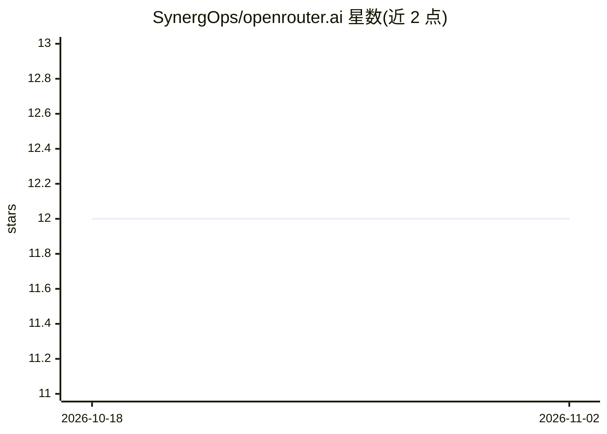

# SynergOps/openrouter.ai

⭐ 12 · Shell · Apache-2.0 · 推送 2026-08-03 · [GitHub](https://github.com/SynergOps/openrouter.ai) · 组织维护

**用个人 API key 在终端与 OpenRouter 模型对话的 shell 脚本**

基于 Bash 的终端聊天应用：通过 OpenRouter API 用用户自己的 API key 发送自然语言提问并获取 AI 回复，支持会话级上下文的多轮对话，聊天记录以带时间戳的 .txt 文件保存到 chat_sessions/ 目录。API key 与模型通过 .env 文件配置，默认使用免费模型，可在 .models 列表中选择其他模型。除 curl 与 jq 外无其他依赖，支持 Linux/macOS/Windows(WSL)，提供 --update 自更新与 DEBUG 调试模式。免费模型有每日 50 次请求的账号级限额。

## 筛选速览

| 维度 | 判定 | 备注 |
|---|---|---|
| AI 角色 | `ai-native` | 本体是模型或模型工具 |
| 许可风险 | `permissive` | Apache-2.0 |
| 部署形态 | `None` |  |
| 模型依赖 | locked-api |  |
| 硬件要求 | — | 无带数字的原话,不猜 |
| 安装摩擦 | `low` | 无编译、无系统依赖或容器化 |
| 成熟度 | — | 结构信号不足 |

## 能力要点

- 会话内保留完整上下文的多轮对话
- 聊天记录保存为带时间戳的 .txt 文件
- 仅依赖 curl 与 jq，无 Python/Node.js
- 默认使用免费模型，.env 可切换模型

## 适用场景

- 在终端里直接向 AI 提问，不想开浏览器
- 用免费额度在多个模型间切换对话
- 保存和回顾带时间戳的聊天记录

## 场景标签

`聊天机器人` · 领域:对话与助手

## 证据(README 行号)

> L3: Simple terminal app to use OpenRouter.ai with your personal API keys. Ask questions directly from your terminal and 
> L12:  - 🤖 Full session memory — ongoing conversations with proper context (stateful chat).

## 星数曲线

2026-10-18 12 → 2026-11-02 12（+0）

---
*卡片 v1 · prompt 1.4 · 生成 2026-11-01 · 置信度 high · 依据 README sha `f6899d375015` · [字段定义](../../DATASET.md)*
