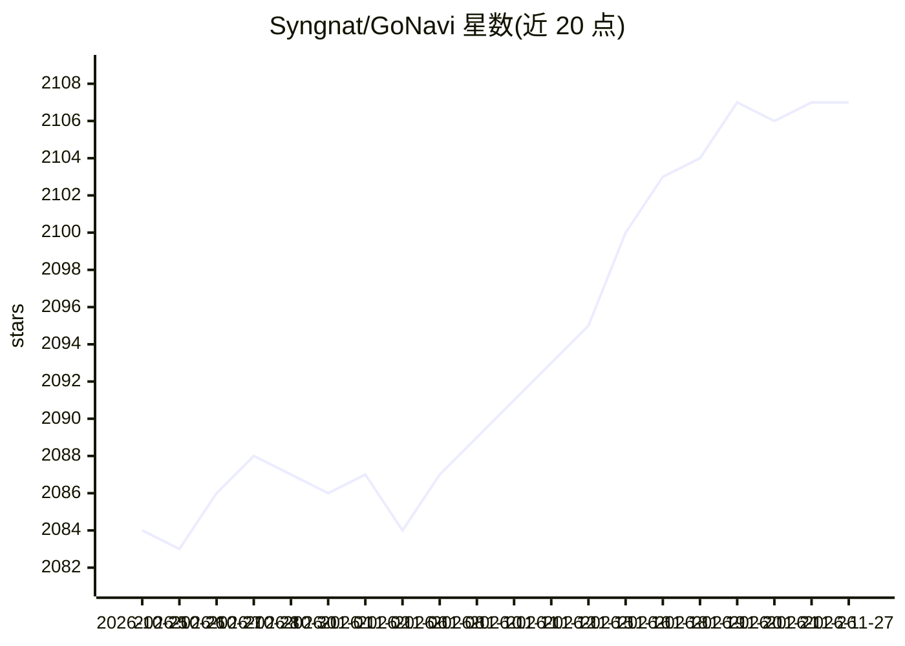

# Syngnat/GoNavi

⭐ 2,107 · TypeScript · Apache-2.0 · 推送 2026-11-26 · [GitHub](https://github.com/Syngnat/GoNavi) · [官网](https://gonavi.org) · 组织维护 · 中文 README

**开发者用的多数据源数据库客户端，内置 AI 助手与 MCP 接入**

基于 Go + Wails + React 构建的跨平台桌面数据库客户端，安装包约 20–26MB，运行时使用系统 WebView 而非 Electron。内置支持 MySQL、PostgreSQL、Redis、Kafka、Milvus 等 12 类数据源，另可通过可选驱动代理接入 MongoDB、ClickHouse、达梦、OceanBase 等数十种。提供 SQL 编辑、虚拟化数据表格、批量编辑、导出、审计中心、SSH 隧道等功能；AI 部分支持 OpenAI/Gemini/Claude 及自定义 OpenAI 兼容 API，可附加表结构上下文生成 SQL，并可通过 MCP 连接多个编码 Agent，密钥保留在本机不外发。

## 筛选速览

| 维度 | 判定 | 备注 |
|---|---|---|
| AI 角色 | `ai-enhanced` | 去掉 AI 部分产品仍成立 |
| 许可风险 | `permissive` | Apache-2.0 |
| 部署形态 | `desktop` | 安装包/桌面程序 |
| 模型依赖 | locked-api |  |
| 硬件要求 | — | 无带数字的原话,不猜 |
| 安装摩擦 | `low` | 无编译、无系统依赖或容器化 |
| 成熟度 | `idea` | |

## 能力要点

- 内置 12 类数据源 + 数十种可选驱动代理（含国产数据库）
- AI 助手可附加实时表结构生成/解释/优化 SQL
- MCP 一键连接 Claude Code / Codex 等编码 Agent，密钥不出本机
- 桌面 + Web Server 双模式，Docker/K8s/Helm/Podman 打包

## 适用场景

- 用一个客户端管理关系库、缓存、向量库、消息队列等多类数据源
- 让 AI 基于真实表结构生成并审查 SQL
- 把数据库结构化上下文交给编码 Agent 而不泄露密码
- 在信创环境接入达梦、人大金仓等国产数据库

## 场景标签

 · 领域:开发者工具/数据库

## 证据(README 行号)

> L56: |AI / Agents|Bolt-on or absent|**First-class MCP + multi-provider AI** (draft SQL; GUI still owns schema / edits / 
> L133: ### 🤖 AI that knows your schema

## 星数曲线

2026-10-25 2,084 → 2026-11-27 2,107（+23）

---
*卡片 v1 · prompt 1.4 · 生成 2026-11-24 · 置信度 high · 依据 README sha `ab7fe3ba9fd5` · [字段定义](../../DATASET.md)*
