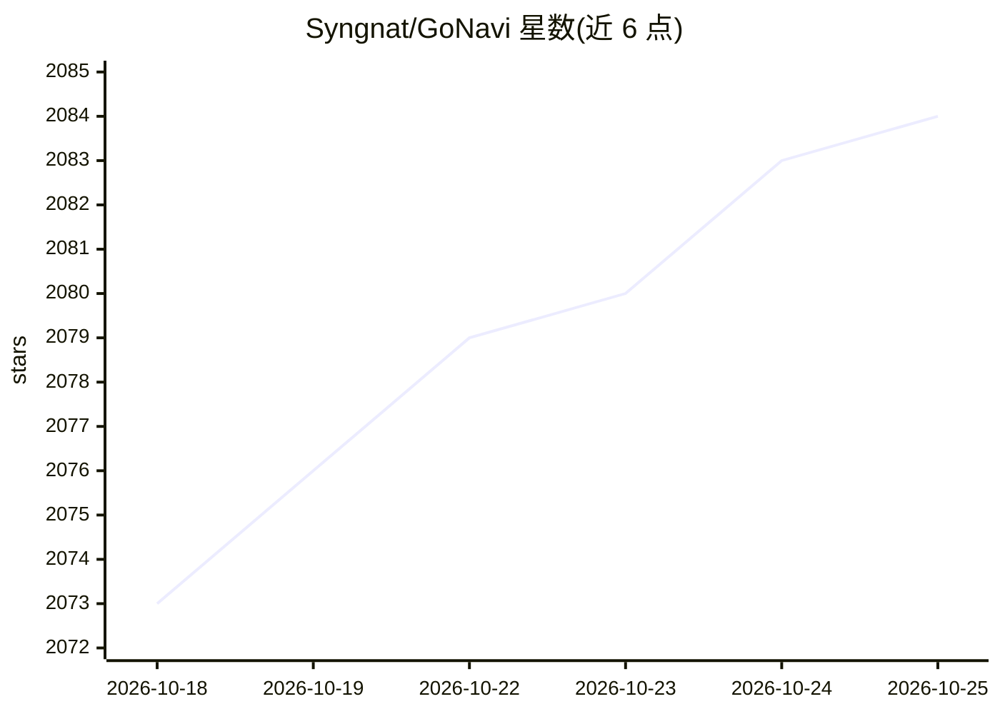

# Syngnat/GoNavi

⭐ 2,083 · TypeScript · Apache-2.0 · 推送 2026-10-25 · [GitHub](https://github.com/Syngnat/GoNavi) · [官网](https://gonavi.org) · 个人维护 · 中文 README

**轻量跨平台多数据源数据库客户端，内置 AI 助手与 MCP 接入**

基于 Wails (Go) + React 构建的桌面优先数据库客户端，安装包约 20–26MB。支持 SQL 关系库、缓存、向量库、消息队列、搜索与时序库等大量数据源（内置 12 种，Driver Manager 可选扩展 40 余种，含国产数据库）。AI 功能包括 schema 上下文感知的多模型助手（OpenAI/Gemini/Claude/自定义 OpenAI 兼容 API）生成与解释 SQL，以及通过 MCP 一键连接 Claude Code、Codex 等编码 agent，密钥保留在本地主机。另含 SQL 审计中心、执行历史、Docker/K8s 打包与实验性 Web Server 模式。

## 筛选速览

| 维度 | 判定 | 备注 |
|---|---|---|
| AI 角色 | `ai-enhanced` | 去掉 AI 部分产品仍成立 |
| 许可风险 | `permissive` | Apache-2.0 |
| 部署形态 | `desktop` | 安装包/桌面程序 |
| 模型依赖 | locked-api |  |
| 硬件要求 | — | 无带数字的原话,不猜 |
| 安装摩擦 | `low` | 无编译、无系统依赖或容器化 |
| 成熟度 | — | 结构信号不足 |

## 能力要点

- 约 20–26MB 安装包，Go + 系统 WebView（非 Electron）
- AI 助手附加实时表结构上下文，斜杠命令生成/解释/优化 SQL
- MCP 一键连接 Claude Code / Codex / OpenCode 等编码 agent，密钥不出本机
- 内置 12 种数据源 + 40 余种可选驱动，含 Redis/Kafka/Milvus/国产数据库

## 适用场景

- 用一个客户端管理 MySQL、Redis、Kafka、Milvus 等多种数据源
- 让 AI 结合表结构生成和审查 SQL
- 通过 MCP 把数据库结构化上下文交给编码 agent 而不泄露密码

## 场景标签

`数据分析` · 领域:效率与自动化

## 证据(README 行号)

> L56: |AI / Agents|Bolt-on or absent|**First-class MCP + multi-provider AI** (draft SQL; GUI still owns schema / edits / 
> L137: - **MCP**: after detecting a locally installed CLI, one-click connect Claude Code / Codex / OpenCode / ZCode / Dee

## 星数曲线

2026-10-18 2,073 → 2026-10-25 2,084（+11）

---
*卡片 v1 · prompt 1.4 · 生成 2026-10-21 · 置信度 high · 依据 README sha `8bb4b67d777e` · [字段定义](../../DATASET.md)*
