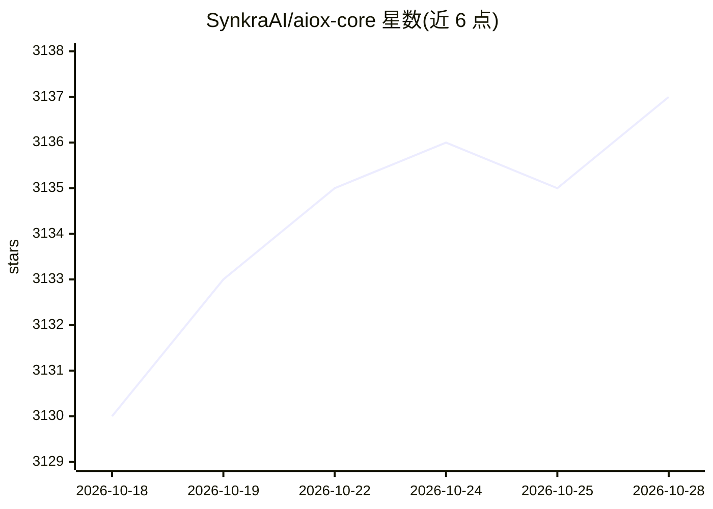

# SynkraAI/aiox-core

⭐ 3,137 · JavaScript · NOASSERTION · 推送 2026-10-28 · [GitHub](https://github.com/SynkraAI/aiox-core) · [官网](https://github.com/allfluence/aios-core) · 组织维护

**面向全栈开发的 AI 多智能体编排框架（CLI 优先，跨 IDE）**

AIOX Squad 是一个 TypeScript/npm 开源的 AI 编排框架，把 analyst/pm/architect/sm/dev/qa 等专职智能体组成 agile 团队，两阶段产出 PRD 与架构文档，再转为含完整上下文的开发故事文件，由 dev 智能体执行。架构优先级为 CLI First → 可观测性 → UI。通过 npx 一条命令安装并自动配置 IDE；提供 Claude Code、Gemini CLI、Codex CLI、Cursor、GitHub Copilot 等平台的集成与 hooks 兼容性对照表。要求 Node.js >=18、npm >=9；npm 包正迁移至 @aiox-squads/core 新命名空间。

## 筛选速览

| 维度 | 判定 | 备注 |
|---|---|---|
| AI 角色 | `ai-ecosystem` | LLM/agent 周边工具 |
| 许可风险 | `none` | NOASSERTION |
| 部署形态 | `library` | 以包/库形式分发 |
| 模型依赖 | — | README 未给出锁定关系 |
| 硬件要求 | — | 无带数字的原话,不猜 |
| 安装摩擦 | `low` | 无编译、无系统依赖或容器化 |
| 成熟度 | — | 结构信号不足 |

## 能力要点

- 两阶段流程：规划智能体生成 PRD/架构，sm 智能体转为超细化故事文件
- CLI First 架构：CLI 为真源，SSE dashboard/Kanban UI 仅观察与管理
- 跨 IDE 集成与 hooks 兼容性对照（Claude Code/Gemini CLI/Codex/Cursor/Copilot）
- 交互式安装器：npx 一条命令完成初始化、IDE 配置与系统健康检查，跨 Windows/macOS/Linux

## 适用场景

- 用 AI 智能体团队（分析/PM/架构/开发/QA）做全栈项目开发
- 在 Claude Code、Codex CLI 等现有 IDE 中接入多智能体敏捷工作流
- 自定义自己领域的智能体与 Squad

## 场景标签

`多智能体` `Agent 框架` `编码 Agent` · 领域:Agent 开发

## 证据(README 行号)

> L17: > **Devolvendo às pessoas o poder de criar** — Framework open source de orquestração de IA que devolve o controle a
> L88: **1. Planejamento Agêntico:** Agentes dedicados (analyst, pm, architect) colaboram com você para criar documentos d
> L92: Esta abordagem de duas fases elimina tanto a **inconsistência de planejamento** quanto a **perda de contexto** - os

## 星数曲线

2026-10-18 3,130 → 2026-10-28 3,137（+7）

---
*卡片 v1 · prompt 1.4 · 生成 2026-10-20 · 置信度 high · 依据 README sha `a7a204ccba62` · [字段定义](../../DATASET.md)*
