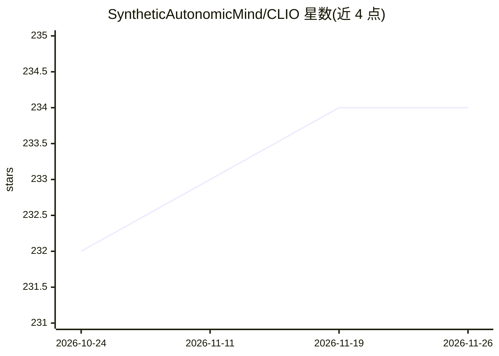

# SyntheticAutonomicMind/CLIO

⭐ 234 · Perl · GPL-3.0 · 推送 2026-11-17 · [GitHub](https://github.com/SyntheticAutonomicMind/CLIO) · 个人维护

**终端内运行的 AI 编码 agent，支持 24 家模型提供方**

CLIO 是用 Perl 编写的终端原生 AI 开发 agent 与可扩展 agent 框架：给定任务后它会调查代码库、提出计划、经批准后实现、运行测试并提交。它向模型暴露 9 个默认工具（文件操作、git、shell、记忆、网页等），支持跨会话记忆、多 agent 协调（Unix socket 消息总线）、SSH 集群部署，并内置秘密脱敏、路径授权、Unicode 注入过滤、沙箱与 Docker 容器隔离等安全层。要求 Perl 5.32+ 与标准 Unix 工具，全部 Perl 模块为核心模块，无外部依赖。代码 GPL-3.0，文档 CC-BY-NC-SA-4.0。

## 筛选速览

| 维度 | 判定 | 备注 |
|---|---|---|
| AI 角色 | `ai-ecosystem` | LLM/agent 周边工具 |
| 许可风险 | `viral` | GPL-3.0 |
| 部署形态 | `None` |  |
| 模型依赖 | local-ok | 支持本地模型 |
| 硬件要求 | — | 无带数字的原话,不猜 |
| 安装摩擦 | `low` | 无编译、无系统依赖或容器化 |
| 成熟度 | — | 结构信号不足 |

## 能力要点

- 支持 24 个 AI 提供方，含 GitHub Copilot、OpenAI、Anthropic、Gemini、DeepSeek、OpenRouter 及 llama.cpp/LM Studio 本地模型，可指向任意 OpenAI 兼容端点
- 9 个默认工具加条件加载工具，MCP 与插件工具动态加载
- 任务中可任意按键中断，下次会话从中断处恢复；跨会话长期记忆存储发现与代码模式
- 六层安全模型：秘密脱敏、命令风险分级、路径授权、Unicode 注入过滤、沙箱、容器隔离

## 适用场景

- 在终端中端到端完成修 bug、补测试、提交的编码任务
- 本地模型后端下让 AI 编码流程不出本机
- 多个 agent 在同一仓库并行工作而互不冲突
- SSH 部署到多台机器并行执行任务并回收结果

## 场景标签

`编码 Agent` `Agent 框架` `Agent 记忆` `多智能体` · 领域:Agent 开发

## 证据(README 行号)

> L11: CLIO is a Perl-based agent harness that works anywhere Perl runs. No CPAN, no pip, no npm - just core Perl and stan
> L3: **A terminal-native AI development agent and extensible agent harness. The model does the reasoning - CLIO provides 

## 星数曲线

2026-10-24 232 → 2026-11-26 234（+2）

---
*卡片 v1 · prompt 1.4 · 生成 2026-11-25 · 置信度 high · 依据 README sha `65ac456ea02f` · [字段定义](../../DATASET.md)*
