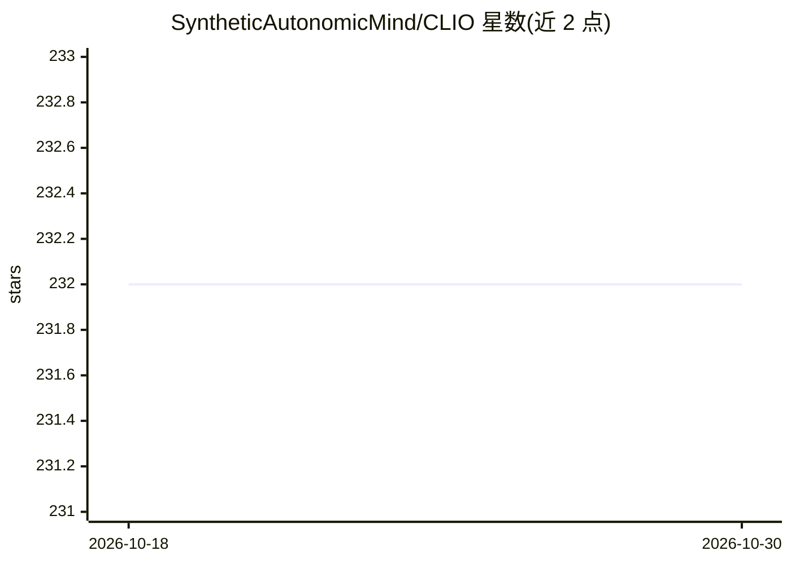

# SyntheticAutonomicMind/CLIO

⭐ 232 · Perl · GPL-3.0 · 推送 2026-10-22 · [GitHub](https://github.com/SyntheticAutonomicMind/CLIO) · 个人维护

**终端 AI 编程代理：多模型接入、带工具与沙箱的 agent 框架**

基于 Perl 5.32+（仅核心模块，无 CPAN/pip/npm 依赖）的终端编程代理与可扩展 agent 框架：读取代码库、提出计划、经批准后实施、运行测试并提交 git。提供 9 个默认工具（文件操作、git、shell、长期记忆、web 等），支持 20 个 AI 提供商含 llama.cpp/LM Studio 本地模型与任意 OpenAI 兼容端点。含密钥脱敏、路径授权、--sandbox 沙箱与 Docker 容器隔离（clio-container）。支持多 agent 并行、SSH 机群部署与 tmux/Screen/Zellij 集成。

## 筛选速览

| 维度 | 判定 | 备注 |
|---|---|---|
| AI 角色 | `ai-native` | 本体是模型或模型工具 |
| 许可风险 | `viral` | GPL-3.0 |
| 部署形态 | `None` |  |
| 模型依赖 | locked-api |  |
| 硬件要求 | — | 无带数字的原话,不猜 |
| 安装摩擦 | `low` | 无编译、无系统依赖或容器化 |
| 成熟度 | — | 结构信号不足 |

## 能力要点

- 20 个 AI 提供商接入，含 llama.cpp/LM Studio 本地模型与 OpenAI 兼容端点
- 仅依赖核心 Perl 与标准 Unix 工具，无 CPAN/pip/npm 外部依赖
- 六层安全机制：密钥脱敏、风险分级命令审批、路径授权、Unicode 注入过滤、沙箱与 Docker 容器隔离
- 跨会话长期记忆、多 agent Unix socket 协作与 SSH 机群并行部署

## 适用场景

- 在终端让 AI 端到端完成找 bug、修复、写回归测试并提交
- 用本地 llama.cpp/LM Studio 模型做私密编程辅助
- 同一仓库内多 agent 并行工作并管理文件与 git 锁

## 场景标签

`编码 Agent` `多智能体` · 领域:Agent 开发

## 证据(README 行号)

> L3: **A terminal-native AI development agent and extensible agent harness. The model does the reasoning - CLIO provides 
> L9: Give CLIO a task and it works through it end to end - investigates your codebase, proposes a plan, implements after 
> L11: CLIO is a Perl-based agent harness that works anywhere Perl runs. No CPAN, no pip, no npm - just core Perl and stan

## 星数曲线

2026-10-18 232 → 2026-10-30 232（+0）

---
*卡片 v1 · prompt 1.4 · 生成 2026-10-22 · 置信度 high · 依据 README sha `59b4b84fa5d2` · [字段定义](../../DATASET.md)*
