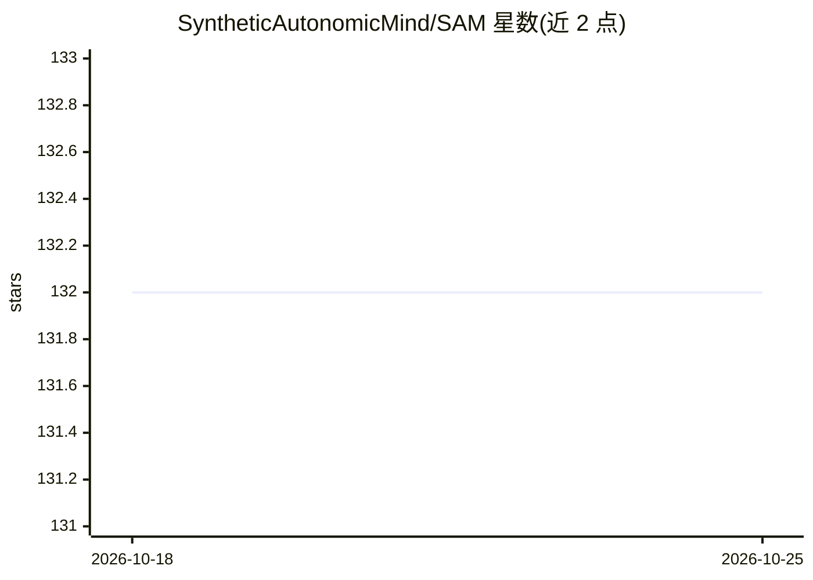

# SyntheticAutonomicMind/SAM

⭐ 132 · Swift · GPL-3.0 · 推送 2026-10-25 · [GitHub](https://github.com/SyntheticAutonomicMind/SAM) · 个人维护

**macOS 原生 AI 助手：面向非开发者，本地/云端模型可选**

Swift 编写的 macOS 桌面 AI 助手，面向不使用命令行的普通用户：支持 PDF/Word/Excel 文档问答、联网调研（Google/Bing/Amazon 等）、写作翻译、通过 ALICE 生成图像、语音唤醒与离线语音识别，以及语义化历史搜索和记忆。可运行本地模型（MLX/llama.cpp），数据存储在本机，也可切换 OpenAI、Gemini、DeepSeek、OpenRouter、Ollama Cloud 等云端提供商，会话中可中途切换。提供 Homebrew cask 安装与 GitHub Releases 手动下载；通过 SAM-Web 可从 iPad/手机浏览器访问。要求 macOS 14+，本地模型建议 16GB+ RAM 与 Apple Silicon。

## 筛选速览

| 维度 | 判定 | 备注 |
|---|---|---|
| AI 角色 | `ai-native` | 本体是模型或模型工具 |
| 许可风险 | `viral` | GPL-3.0 |
| 部署形态 | `None` |  |
| 模型依赖 | local-ok | 支持本地模型 |
| 硬件要求 | — | 无带数字的原话,不猜 |
| 安装摩擦 | `low` | 无编译、无系统依赖或容器化 |
| 成熟度 | — | 结构信号不足 |

## 能力要点

- 本地 MLX / llama.cpp 运行模型，数据留在本机，零遥测
- 十余种云端提供商可选，支持会话中切换（含 OpenAI/Gemini/DeepSeek/OpenRouter/Ollama Cloud/Z.AI）
- 文档问答、跨站购物调研、文本生成图像（ALICE）、LoRA 应用
- Hey SAM 语音唤醒与离线语音识别；SAM-Web 支持浏览器访问

## 适用场景

- 上传 PDF 等文档直接提问，无需命令行
- 在 Amazon/Walmart/eBay 等站点间做购物调研
- 隐私敏感场景下用本地模型处理对话与文档
- 用语音免手操作管理文件、做计算

## 场景标签

`AI 助手` `文档问答` `图像生成` `语音识别` · 领域:对话与助手

## 证据(README 行号)

> L15: SAM is a native macOS app for people who aren't developers. Say "Hey SAM" to go hands-free. Upload a PDF and ask qu
> L17: **Your data stays on your Mac.** Run local models with MLX or llama.cpp and nothing leaves your machine. Switch to 

## 星数曲线

2026-10-18 132 → 2026-10-25 132（+0）

---
*卡片 v1 · prompt 1.4 · 生成 2026-10-22 · 置信度 high · 依据 README sha `cd5771eb82d5` · [字段定义](../../DATASET.md)*
