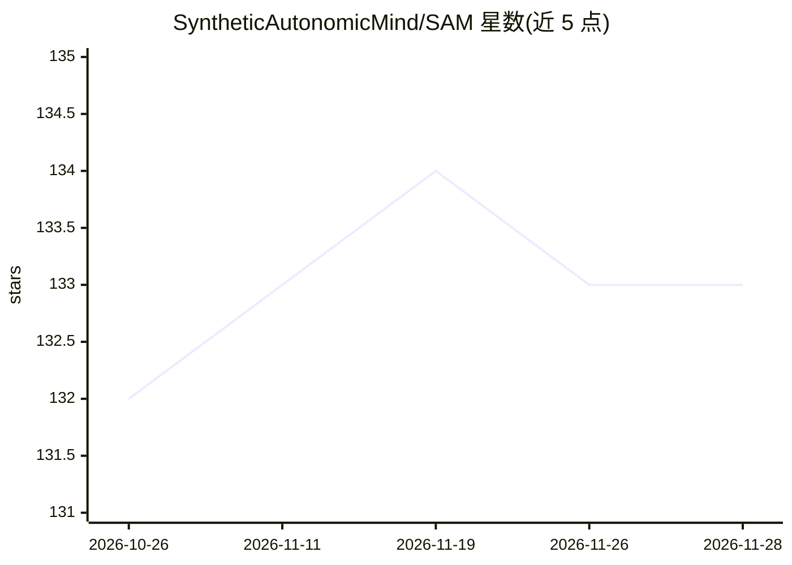

# SyntheticAutonomicMind/SAM

⭐ 133 · Swift · GPL-3.0 · 推送 2026-11-20 · [GitHub](https://github.com/SyntheticAutonomicMind/SAM) · 个人维护

**面向非开发者的本地优先 macOS AI 助手**

SAM 是一款原生 macOS 桌面应用，面向非开发者用户提供文档问答、在线购物调研、写作辅助、图像生成、语音控制与文件管理等功能。通过「Hey SAM」唤醒词免手操作，支持上传 PDF/Word/Excel 提问，接入 MLX 或 llama.cpp 运行本地模型使数据留在本机，也可切换到多家云服务商。对话历史本地存储、API key 存于 macOS Keychain、无遥测。通过 Homebrew cask 或 GitHub Releases 安装，需 macOS 14+。

## 筛选速览

| 维度 | 判定 | 备注 |
|---|---|---|
| AI 角色 | `ai-native` | 本体是模型或模型工具 |
| 许可风险 | `viral` | GPL-3.0 |
| 部署形态 | `None` |  |
| 模型依赖 | local-ok | 支持本地模型 |
| 硬件要求 | — | 无带数字的原话,不猜 |
| 安装摩擦 | `low` | 无编译、无系统依赖或容器化 |
| 成熟度 | — | 结构信号不足 |

## 能力要点

- 本地模型（MLX/llama.cpp）运行，数据不出本机，零遥测
- 「Hey SAM」唤醒词语音控制，含语音识别与 TTS，可离线工作
- 十余家 AI 服务商可中途切换，含本地与 OpenAI 兼容自定义接入
- 内置数学计算用 Python 求值而非模型近似

## 适用场景

- 上传 PDF/Word/Excel 并就内容提问
- 在一次对话中跨 Amazon/Walmart/eBay 调研购物
- 用本地模型离线使用语音助手功能
- 生成图像并应用 LoRA 风格适配器

## 场景标签

`AI 助手` `语音 Agent` `文档问答` `图像生成` · 领域:对话与助手

## 证据(README 行号)

> L15: SAM is a native macOS app for people who aren't developers. Say "Hey SAM" to go hands-free. Upload a PDF and ask qu
> L17: **Your data stays on your Mac.** Run local models with MLX or llama.cpp and nothing leaves your machine. Switch to 
> L70:  Choose from local models (MLX, llama.cpp) or cloud providers (OpenAI, GitHub Copilot, Google Gemini, DeepSeek, Min

## 星数曲线

2026-10-26 132 → 2026-11-28 133（+1）

---
*卡片 v1 · prompt 1.4 · 生成 2026-11-28 · 置信度 high · 依据 README sha `cdd286d1c974` · [字段定义](../../DATASET.md)*
