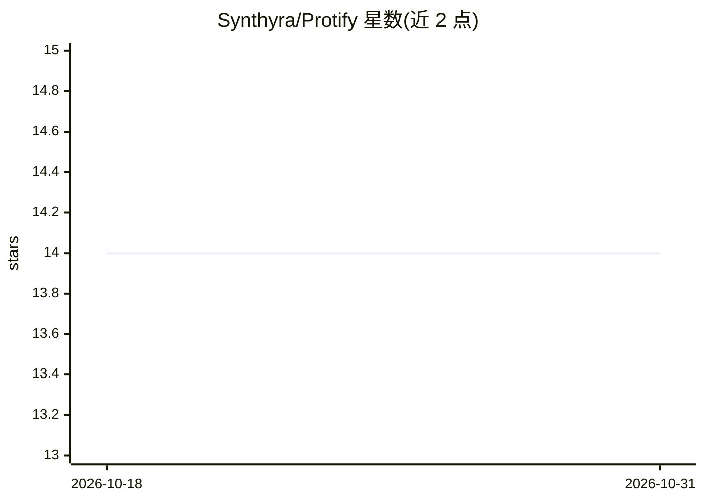

# Synthyra/Protify

⭐ 14 · Python · Apache-2.0 · 推送 2026-10-22 · [GitHub](https://github.com/Synthyra/Protify) · [官网](https://synthyra.com/) · 组织维护

**低代码蛋白质/化学语言模型训练与基准平台**

面向化学与蛋白质语言模型工作流的低代码开源平台：内置 40 余个蛋白质语言模型（ESM2、ESMC、ProtT5、DPLM 等）与 50 余个数据集（定位、功能、PPI、稳定性、结合亲和力等任务），支持以代码或无代码界面训练深度学习模型预测化学/蛋白质性质，并生成可用于发表的基准图表。无 GPU 时可下载 Synthyra 预计算嵌入配合 scikit-learn 分析，或通过 Synthyra API 以 API key 运行 GPU 训练。项目自述处于 beta 阶段。

## 筛选速览

| 维度 | 判定 | 备注 |
|---|---|---|
| AI 角色 | `ai-ecosystem` | LLM/agent 周边工具 |
| 许可风险 | `permissive` | Apache-2.0 |
| 部署形态 | `self-host` | docker 或自建部署 |
| 模型依赖 | — | README 未给出锁定关系 |
| 硬件要求 | — | 无带数字的原话,不猜 |
| 安装摩擦 | `low` | 无编译、无系统依赖或容器化 |
| 成熟度 | `idea` | |

## 能力要点

- 内置 40+ 蛋白质语言模型与 50+ 基准数据集
- 无代码界面与代码流水线两种使用方式
- 支持无 GPU 场景：预计算嵌入 + scikit-learn 或 Synthyra API 云端训练
- 多模型对多数据集批量基准测试并输出发表级图表

## 适用场景

- 不写代码即可训练模型预测蛋白质性质
- 批量基准测试多个蛋白质语言模型在多个数据集上的表现
- 无 GPU 环境下用预计算嵌入做蛋白质性质分析

## 场景标签

`模型评测` `模型训练` `微调` · 领域:评测与运维

## 证据(README 行号)

> L56: Protify is an open source platform designed to simplify and democratize workflows for chemical language models. Wit
> L60: - **Benchmark multiple models efficiently**: Need to evaluate 10 different protein language models against 15 diver
> L61: - **Flexible for all skill levels**: Build custom pipelines with code or use our no-code interface depending on you

## 星数曲线

2026-10-18 14 → 2026-10-31 14（+0）

---
*卡片 v1 · prompt 1.4 · 生成 2026-10-31 · 置信度 high · 依据 README sha `03253dde7b22` · [字段定义](../../DATASET.md)*
