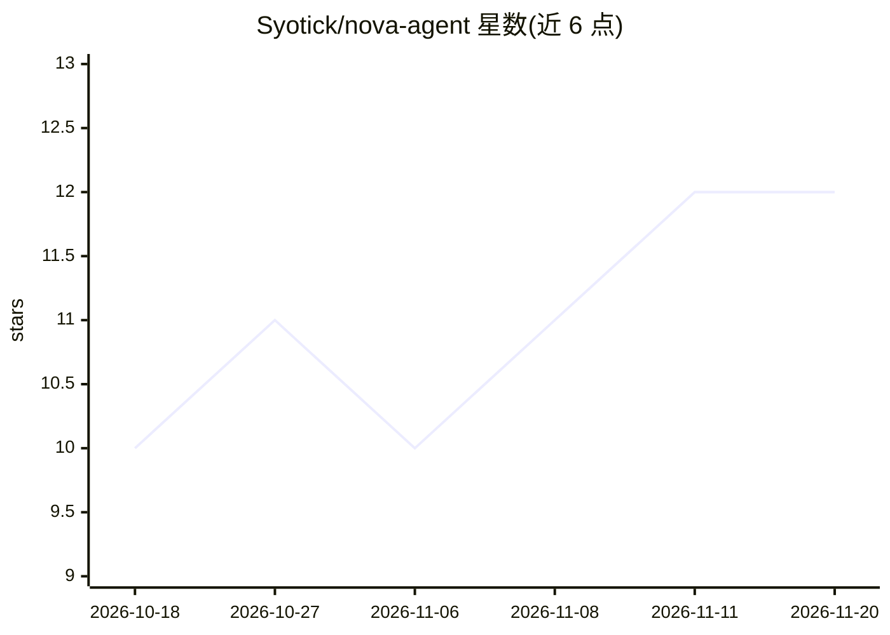

# Syotick/nova-agent

⭐ 12 · TypeScript · MIT · 推送 2026-09-17 · [GitHub](https://github.com/Syotick/nova-agent) · [官网](https://github.com/Syotick/nova-agent/blob/main/docs/guide/README.md) · 个人维护 · 中文 README

**面向学习者的可运行 AI Agent 教学项目，覆盖 agent loop 与 MCP**

一个自包含的开源 AI Agent 项目，实现 agent 循环、MCP 工具接入、SKILL.md 技能系统、跨会话记忆、上下文压缩、定时任务与多 Agent 管理，前后端一体（React 19 + Express + SQLite），约 9,400 行 TypeScript。定位为教学项目：配套课程地图、练习册、验收项目与术语总表，声明功能冻结、重心在教材。面向在校大学生与转行做 Agent 开发的开发者；运行仅需 Node 22+ 与 OpenAI 兼容 API key。README 自述不打算与 Claude Code/Cursor 等商业产品竞争。

## 筛选速览

| 维度 | 判定 | 备注 |
|---|---|---|
| AI 角色 | `ai-native` | 本体是模型或模型工具 |
| 许可风险 | `permissive` | MIT |
| 部署形态 | `library` | 以包/库形式分发 |
| 模型依赖 | locked-api |  |
| 硬件要求 | — | 无带数字的原话,不猜 |
| 安装摩擦 | `low` | 无编译、无系统依赖或容器化 |
| 成熟度 | — | 结构信号不足 |

## 能力要点

- agent 循环 + MCP 工具 + SKILL.md 技能按需加载（目录注入，load_skill 取正文）
- 上下文压缩与护栏：token 感知阈值压缩、超大工具输出修剪、超限自动重试
- 多 Agent 管理、后台子代理父子通信、5 段 cron 定时任务
- 配套课程地图/练习册/验收项目的教学资料

## 适用场景

- 按课程路径从源码学习 agent loop、MCP 与技能系统如何实现
- 本地跑一个厂商中立、零遥测的自托管 Agent
- 丢一个 SKILL.md 文件夹或 JSON 配置扩展技能与工具
- 用定时任务让 Agent 定时执行周期性工作

## 场景标签

`教程课程` `Agent 框架` · 领域:Agent 开发

## 证据(README 行号)

> L18: **Nova Agent** 是一个好学、开箱即用的开源 AI Agent。Agent 循环、MCP 工具、Agent Skills、记忆、任务自动化——整个设计目标是一个晚上读完、能跑起来、然后动手改。面向在校大学生和转行做 A
> L26: - **在校大学生和转行开发者**，想弄明白 Agent 到底怎么工作。从 agent loop 读起，再看 MCP 客户端和 SKILL.md 加载器，然后拆开、修好它。
> L35: - ✅ **Agent 循环**：Vercel AI SDK `streamText` 多步工具调用循环（默认最多 24 步，`NOVA_AGENT_MAX_STEPS` 可调）

## 星数曲线

2026-10-18 10 → 2026-11-20 12（+2）

---
*卡片 v1 · prompt 1.4 · 生成 2026-11-18 · 置信度 high · 依据 README sha `8a4e665e19f0` · [字段定义](../../DATASET.md)*
