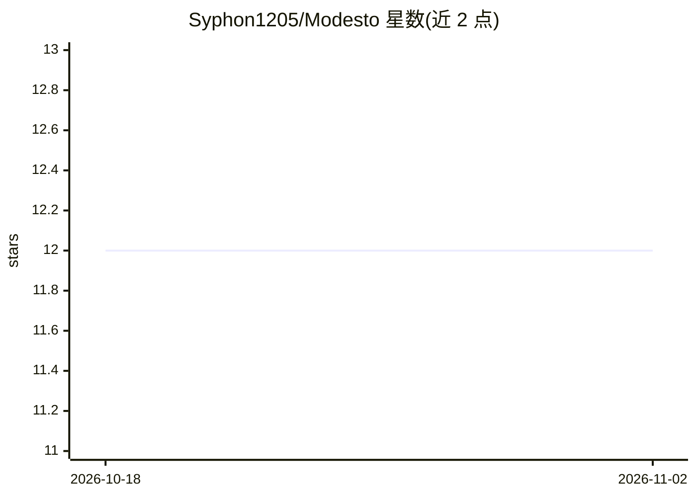

# Syphon1205/Modesto

⭐ 12 · TypeScript · NOASSERTION · 推送 2026-09-26 · [GitHub](https://github.com/Syphon1205/Modesto) · [官网](https://github.com/Syphon1205/Modesto/releases/latest) · 个人维护

**把各家编码 agent CLI 聚到一个本地桌面工作台**

基于 Electron 的开源桌面应用（React/Bun 服务端），将 Codex、Claude、Cursor、Gemini、Grok 等已付费的编码 agent CLI 统一到一个工作台：Chat 对话与 Work 仓库工作两种模式，含 PR 审查、任务看板、自动化、Connections（Figma/Slack/MCP 等）、终端、worktree 隔离会话，并支持跨 provider 的上下文交接与检查点。需用户本地已安装对应编码 CLI 才能进行实时 agent 会话。提供 macOS/Windows/Linux 安装包，AGPL-3.0 许可。

## 筛选速览

| 维度 | 判定 | 备注 |
|---|---|---|
| AI 角色 | `ai-native` | 本体是模型或模型工具 |
| 许可风险 | `viral` | NOASSERTION |
| 部署形态 | `desktop` | 安装包/桌面程序 |
| 模型依赖 | locked-api |  |
| 硬件要求 | — | 无带数字的原话,不猜 |
| 安装摩擦 | `low` | 无编译、无系统依赖或容器化 |
| 成熟度 | `idea` | |

## 能力要点

- 统一 picker 发现并切换多个编码 agent CLI，切换时保留上下文
- Work 模式提供 worktree 隔离、终端、diff、PR 与跨 provider 交接检查点
- Connections 接入 Figma、Slack、Linear、Adobe、MCP 等工具
- v0.1.9 起内置 Poolside、Kimi、Qwen 等 CLI 的应用内安装与健康检查

## 适用场景

- 在同一桌面端管理并切换多个已订阅的编码 agent CLI
- 仓库内做带 worktree 隔离与终端的 agent 驱动开发
- 在 agent 之间交接任务并保留检查点与上下文

## 场景标签

`编码 Agent` `代码审查` · 领域:编码与开发

## 证据(README 行号)

> L22: Codex, Claude, Cursor, Gemini, Grok, Meta Muse Code, and friends stay the CLIs you already pay for. Modesto just pu
> L49: **Default agents** — Codex, Claude, Cursor, Gemini, Grok, Meta Muse Code, Kilo. Switch mid-thread. They keep the co
> L146: Requirements: **Bun 1.3.9+**, **Node.js 24.13.1+**, and a locally installed coding provider for live agent session

## 星数曲线

2026-10-18 12 → 2026-11-02 12（+0）

---
*卡片 v1 · prompt 1.4 · 生成 2026-11-01 · 置信度 high · 依据 README sha `12bcbb00e463` · [字段定义](../../DATASET.md)*
