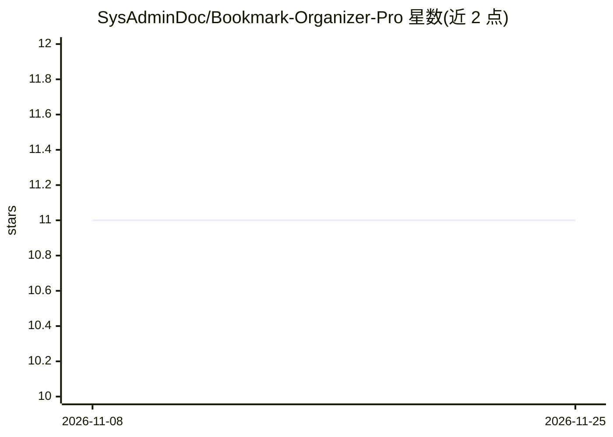

# SysAdminDoc/Bookmark-Organizer-Pro

⭐ 11 · Python · MIT · 推送 2026-11-19 · [GitHub](https://github.com/SysAdminDoc/Bookmark-Organizer-Pro) · 个人维护

**本地优先的书签与研究资料管理桌面工具，AI 分类可选启用**

本地优先的桌面书签与研究资料管理器：将浏览器收藏、离线快照、高亮和搜索索引保存在本机，AI 与 MCP 访问为可选启用。提供 69 个 CLI 子命令、37 个 MCP 工具、本地 REST API（Bearer token 鉴权与只读/读写分权）、Chromium 与 Firefox 的 MV3 浏览器扩展，以及 PyQt 桌面界面。支持语义/混合检索、嵌入重建、YouTube 字幕转录（需主动选择）、阅读进度记录、快照完整性与 ZIP 导出，并附带视觉/可访问性回归冒烟脚本与性能基准门槛。PyPI 安装，Windows 构建流程经验证。

## 筛选速览

| 维度 | 判定 | 备注 |
|---|---|---|
| AI 角色 | `ai-enhanced` | 去掉 AI 部分产品仍成立 |
| 许可风险 | `permissive` | MIT |
| 部署形态 | `desktop` | 安装包/桌面程序 |
| 模型依赖 | local-ok | 支持本地模型 |
| 硬件要求 | — | 无带数字的原话,不猜 |
| 安装摩擦 | `low` | 无编译、无系统依赖或容器化 |
| 成熟度 | — | 结构信号不足 |

## 能力要点

- 69 个 CLI 子命令与 37 个 MCP 工具的可执行产品契约
- 本地 REST API 支持只读/读写/扩展三种凭据与轮换撤销
- Chromium/Firefox MV3 扩展与 Side Panel/Reading List 导入
- 快照存储带 MIME、SHA-256、后端与 UTC 时间戳的版本化清单

## 适用场景

- 把浏览器收藏和离线副本集中管理并做语义搜索
- 通过 MCP 让本地客户端直接查询书签库
- 阅读文献时保存高亮并设置复习提醒
- 为书签库生成浏览器扩展以便随时保存当前标签页

## 场景标签

`语义搜索` `科研工具` `知识库管理` · 领域:知识与检索

## 证据(README 行号)

> L3: Bookmark Organizer Pro is a local-first desktop bookmark and research manager. It keeps browser saves, offline copie
> L5: Executable product contract: 69 CLI subcommands, 37 MCP tools, 6 AI providers, 3 extension surfaces, 59 service modu

## 星数曲线

2026-11-08 11 → 2026-11-25 11（+0）

---
*卡片 v1 · prompt 1.4 · 生成 2026-11-18 · 置信度 high · 依据 README sha `db64f9341184` · [字段定义](../../DATASET.md)*
