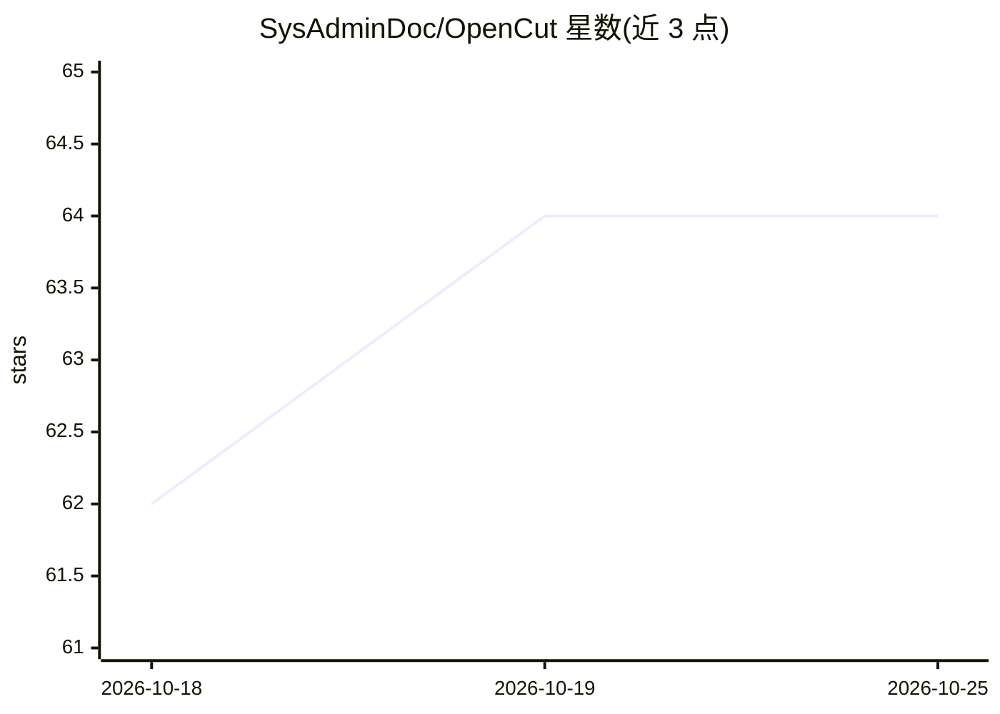

# SysAdminDoc/OpenCut

⭐ 64 · Python · MIT · 推送 2026-09-26 · [GitHub](https://github.com/SysAdminDoc/OpenCut) · 个人维护

**Adobe Premiere Pro 的本地 AI 视频编辑自动化扩展**

面向视频剪辑者的 Premiere Pro 扩展（CEP/UXP 面板 + Flask 后端 + CLI + MCP 服务器，共 310 个已发布路由）：提供静音/填充词剪切、55 种风格字幕、干声分离、语音克隆、本地 LLM 高亮摘要与多平台社媒导出；核心本地功能无需 API key，云服务与上传为可选。通过 Windows 安装包、Install.bat、源码（pip -e）或 Docker 安装；系统依赖 FFmpeg（需校验过 CVE 的 2026-07-06 后快照），Torch 后端（Demucs/pyannote 等）按需通过 extras 安装。

## 筛选速览

| 维度 | 判定 | 备注 |
|---|---|---|
| AI 角色 | `ai-native` | 本体是模型或模型工具 |
| 许可风险 | `permissive` | MIT |
| 部署形态 | `desktop` | 安装包/桌面程序 |
| 模型依赖 | — | README 未给出锁定关系 |
| 硬件要求 | — | 无带数字的原话,不猜 |
| 安装摩擦 | `low` | 无编译、无系统依赖或容器化 |
| 成熟度 | — | 结构信号不足 |

## 能力要点

- 静音/填充词剪切直接写入时间线，可无限次复核
- 55 种风格动画字幕与可导出产物
- 本地 LLM 高亮、干声分离、语音克隆，核心功能无需 API key
- CEP/UXP 面板 + HTTP API(5679) + MCP 服务器，Docker 部署为纯 CPU 镜像

## 适用场景

- 在 Premiere Pro 里自动完成剪口与字幕，省去手工操作
- 为多平台社媒导出规格化视频
- 本地运行转录/干声分离等处理，不上传素材

## 场景标签

`语音合成` `语音识别` `图像视频处理` · 领域:内容生成

## 证据(README 行号)

> L22:  > **OpenCut replaces ~$1,400/year of video-editing subscriptions** with a free, MIT-licensed Premiere Pro extensio
> L68: - **Adobe Premiere Pro** 2019 or later (CEP panel) / 25.6+ (UXP panel)
> L126: 5. Optionally install Whisper for caption generation

## 星数曲线

2026-10-18 62 → 2026-10-25 64（+2）

---
*卡片 v1 · prompt 1.4 · 生成 2026-10-24 · 置信度 mid · 依据 README sha `0d5cd6320faf` · [字段定义](../../DATASET.md)*
