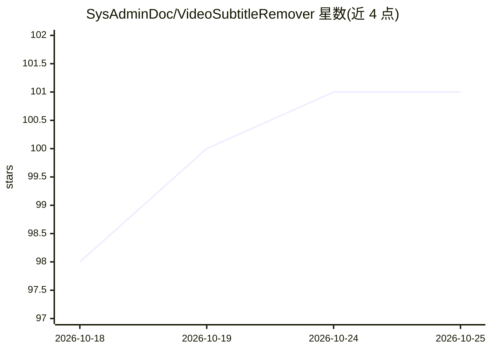

# SysAdminDoc/VideoSubtitleRemover

⭐ 101 · Python · MIT · 推送 2026-09-26 · [GitHub](https://github.com/SysAdminDoc/VideoSubtitleRemover) · [官网](https://github.com/SysAdminDoc/VideoSubtitleRemover/releases/latest) · 个人维护

**本地去除视频硬字幕与文字的 Windows 桌面应用**

面向 Windows 用户的视频字幕/文字清除桌面工具：OCR 多引擎检测文字轨道，用 TBE 时域背景重建与 LaMa 神经网络修补重建文字下方像素，支持遮罩人工审查与修正后再渲染。全部处理在本地完成，默认不联网下载模型；提供 CPU 与 NVIDIA 两种安装包，另带 CLI 与预设。基于 YaoFANGUK/video-subtitle-remover 扩展，要求 Windows 10+、8GB 内存，NVIDIA 路径建议 RTX 2060+ 与 6GB 显存。

## 筛选速览

| 维度 | 判定 | 备注 |
|---|---|---|
| AI 角色 | `ai-native` | 本体是模型或模型工具 |
| 许可风险 | `permissive` | MIT |
| 部署形态 | `desktop` | 安装包/桌面程序 |
| 模型依赖 | — | README 未给出锁定关系 |
| 硬件要求 | `cpu-ok` | |
| 安装摩擦 | `low` | 无编译、无系统依赖或容器化 |
| 成熟度 | — | 结构信号不足 |

## 能力要点

- 多引擎 OCR 检测（RapidOCR/PaddleOCR/Surya 等）与文字轨道审查
- TBE 时域背景重建与 LaMa/ONNX Runtime 神经网络修补
- 遮罩绘制、修正、关键帧插值与单帧试清预览
- CPU 与 NVIDIA 两种构建，处理全程本地进行

## 适用场景

- 清除烧录在视频中的字幕或文字水印而不裁剪画面
- 先审查遮罩与检测轨道再进行长时间渲染
- 批量处理文件夹内的视频并支持断点续跑

## 场景标签

`图像视频处理` · 领域:感知与多模态

## 证据(README 行号)

> L29: - It rebuilds pixels under text with temporal evidence and local inpainting. The frame isn't blurred, cropped, or c
> L68: - **Real Video Inpainting:** Temporal Background Exposure (TBE) reconstructs the true background from neighbouring 
> L92: - **GPU Acceleration:** NVIDIA CUDA, AMD/Intel DirectML through ONNX Runtime, hardware-decode hints (D3D11 / VAAPI 

## 星数曲线

2026-10-18 98 → 2026-10-25 101（+3）

---
*卡片 v1 · prompt 1.4 · 生成 2026-10-24 · 置信度 mid · 依据 README sha `b6c1302c33ac` · [字段定义](../../DATASET.md)*
