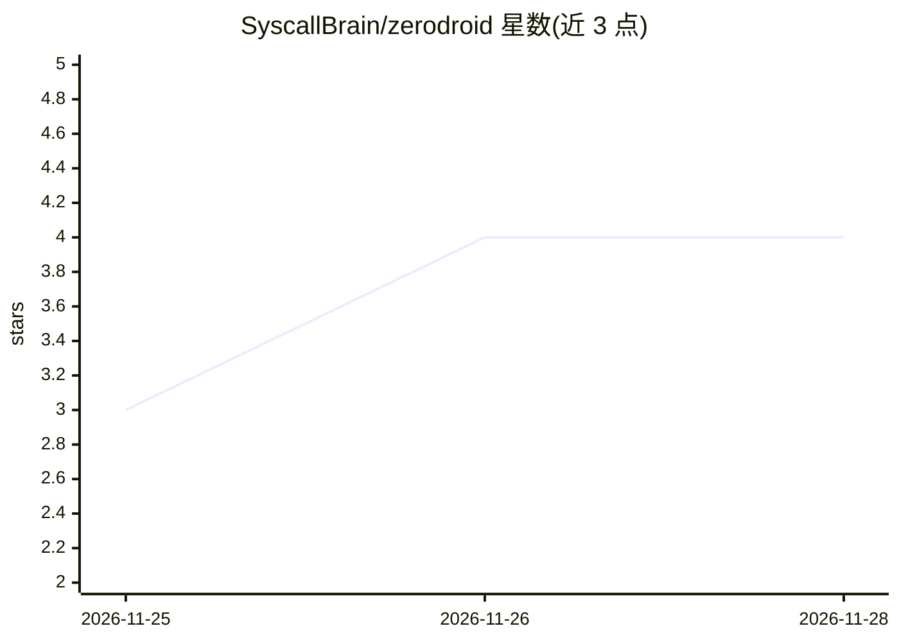

# SyscallBrain/zerodroid

⭐ 4 · Kotlin · MIT · 推送 2026-11-26 · [GitHub](https://github.com/SyscallBrain/zerodroid) · 组织维护

**ZeroClaw 代理守护进程的原生 Android 手机客户端**

ZeroClaw 守护进程的 Android 客户端，定位为遥控器而非第二个运行时：代理、工具与记忆均在守护进程侧。功能包括多会话聊天（流式 Markdown、工具调用参数与输出展示）、以 diff 查看文件编辑、构建与运行守护进程的 SOP 工作流、Canvas 图表留存、定时任务、运行 zeroclaw doctor 检查、通知中审批代理请求。通过 mTLS 1.3 配对或 OIDC 登录连接守护进程；部分功能（Automation、会话持久化）需给守护进程打补丁。以 APK 分发，需 Android 10+ 与 ZeroClaw 0.9.0+。

## 筛选速览

| 维度 | 判定 | 备注 |
|---|---|---|
| AI 角色 | `ai-ecosystem` | LLM/agent 周边工具 |
| 许可风险 | `permissive` | MIT |
| 部署形态 | `None` |  |
| 模型依赖 | — | README 未给出锁定关系 |
| 硬件要求 | — | 无带数字的原话,不猜 |
| 安装摩擦 | `low` | 无编译、无系统依赖或容器化 |
| 成熟度 | — | 结构信号不足 |

## 能力要点

- 聊天、工作流、审批、配置管理均在手机端完成，守护进程可运行于 Termux 或家用机器
- mTLS 1.3 配对，客户端密钥存于 Android Keystore，短码比对防静默配对
- 工具调用可视化：参数、输出与文件编辑 diff 查看
- 前后台保持运行中的会话连接

## 适用场景

- 在手机上与家里或手机上运行的 ZeroClaw 代理对话
- 代理请求敏感操作时从通知栏审批放行
- 在手机上编辑和运行守护进程的定时任务与 SOP 工作流

## 场景标签

`AI 助手` `聊天机器人` · 领域:对话与助手

## 证据(README 行号)

> L26: ZeroDroid is a native Android client for the ZeroClaw
> L32: It is a remote control, not a second runtime: agents, tools, channels and

## 星数曲线

2026-11-25 3 → 2026-11-28 4（+1）

---
*卡片 v1 · prompt 1.4 · 生成 2026-11-24 · 置信度 high · 依据 README sha `50c7dcab836c` · [字段定义](../../DATASET.md)*
