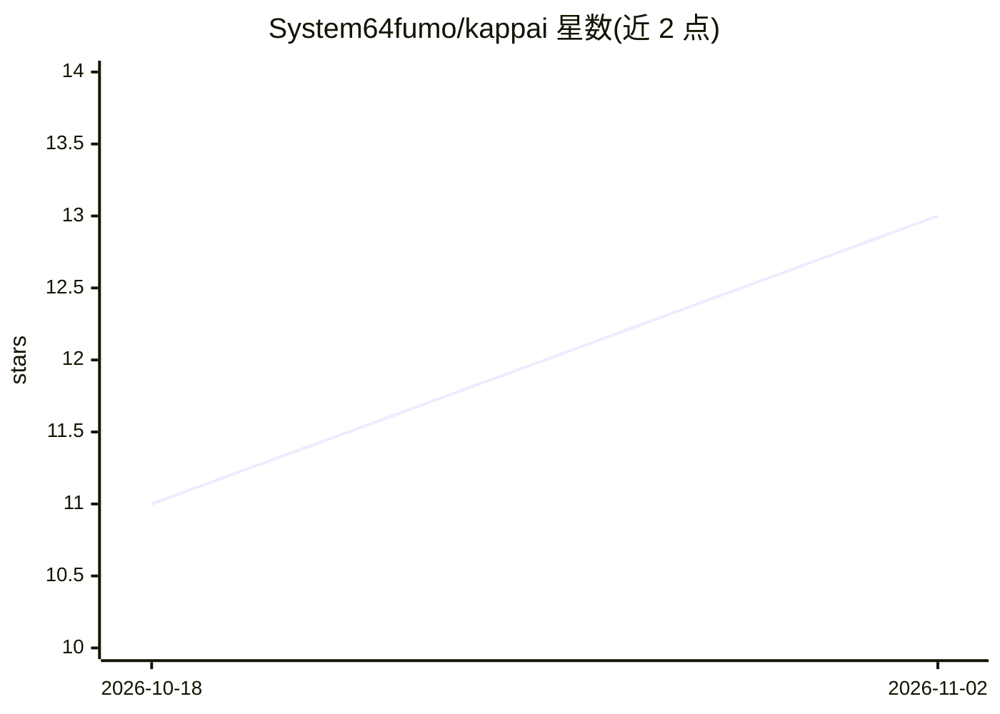

# System64fumo/kappai

⭐ 13 · C · MIT · 推送 2026-11-01 · [GitHub](https://github.com/System64fumo/kappai) · 个人维护

**面向低端硬件优化的本地 LLM 推理引擎**

本地 AI 推理引擎，以性能与效率为优先目标，宣称可让低端系统获得加速（最高 800% 因系统而异）。支持 CPU 标量/aarch64/x86_64、Vulkan、OpenGL 多后端，读取 GGUF 格式模型（Legacy/K-quants/I-quants/Float 量化），覆盖 Llama、Gemma、LFM、Qwen、GLM 等架构。提供交互式 CLI、手动 CLI 与 OpenAI 兼容服务器，支持工具调用、MoE 流式与扩散模型。从源码 make 构建，需自行编译。README 自述含 AI 生成代码，仅供教育用途，不用于生产环境。

## 筛选速览

| 维度 | 判定 | 备注 |
|---|---|---|
| AI 角色 | `ai-ecosystem` | LLM/agent 周边工具 |
| 许可风险 | `permissive` | MIT |
| 部署形态 | `None` |  |
| 模型依赖 | local-ok | 支持本地模型 |
| 硬件要求 | — | 无带数字的原话,不猜 |
| 安装摩擦 | `medium` | 含编译或系统依赖之一 |
| 成熟度 | `idea` | |

## 能力要点

- CPU/Vulkan/OpenGL 多后端与异构计算调度器
- OpenAI 兼容服务器与工具调用
- GGUF 多种量化格式支持
- 支持 Linux(aarch64/riscv64/x86_64) 与 macOS(aarch64)

## 适用场景

- 在低配机器上本地运行 GGUF 量化模型
- 通过 OpenAI 兼容接口本地提供推理服务
- 在无独显设备上做 CPU/Vulkan 推理实验

## 场景标签

`推理引擎` · 领域:训练与推理

## 证据(README 行号)

> L11: Kappai is a local AI inference engine that heavily prioritizes performance and efficiency.
> L22: - OpenAI-compatible server

## 星数曲线

2026-10-18 11 → 2026-11-02 13（+2）

---
*卡片 v1 · prompt 1.4 · 生成 2026-11-02 · 置信度 high · 依据 README sha `29052a70b366` · [字段定义](../../DATASET.md)*
