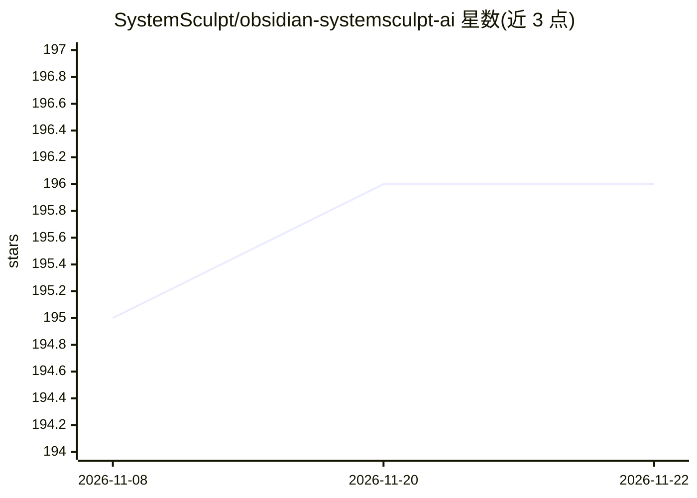

# SystemSculpt/obsidian-systemsculpt-ai

⭐ 196 · TypeScript · MIT · 推送 2026-11-16 · [GitHub](https://github.com/SystemSculpt/obsidian-systemsculpt-ai) · [官网](https://systemsculpt.com/?utm_source=github&utm_medium=repo&utm_campaign=evergreen&utm_content=obsidian-plugin) · 组织维护

**让 Claude Code/Codex 或托管 AI 处理 Obsidian 笔记的插件**

Obsidian 插件，把用户自己安装的桌面版 Claude Code 或 Codex（以本机子进程方式启动，保留各自登录与权限体系）或 SystemSculpt 托管 AI 接入笔记库：聊天问答、附件、代理式创建/编辑笔记（Auto/Ask/Full access 审批模式）、Studio 工作流、音频与 YouTube 转写、相似笔记语义索引、图像视频生成。托管功能需 SystemSculpt 账户与积分，新账户可领 500 一次性积分，付费 $9/月或 $90/年。6.x 托管后端不再支持自有 API key、自定义端点与本地模型。插件无客户端遥测。

## 筛选速览

| 维度 | 判定 | 备注 |
|---|---|---|
| AI 角色 | `ai-native` | 本体是模型或模型工具 |
| 许可风险 | `permissive` | MIT |
| 部署形态 | `None` |  |
| 模型依赖 | locked-api |  |
| 硬件要求 | — | 无带数字的原话,不猜 |
| 安装摩擦 | `medium` | 含编译或系统依赖之一 |
| 成熟度 | — | 结构信号不足 |

## 能力要点

- 桌面端以子进程接入用户自己的 Claude Code 与 Codex，无需 SystemSculpt 账户
- Auto/Ask/Full access 审批模式控制笔记修改
- 音频/YouTube 转写为 Markdown 或 SRT 并生成摘要与行动项
- Similar Notes 语义索引查找含义相近笔记

## 适用场景

- 和自己的笔记库对话，让代理搜索、创建和编辑笔记
- 把录音或 YouTube 视频转成带摘要的笔记
- 在 Obsidian 内用本地 Claude Code/Codex 跑 Studio 工作流

## 场景标签

`AI 助手` `知识库管理` `语音识别` `语义搜索` · 领域:对话与助手

## 证据(README 行号)

> L3: **Put Claude Code, Codex or hosted AI to work on your Obsidian notes.**
> L5: - **Chat with your vault.** Ask about your notes, attach files and images, and let the agent search, create and edit
> L29: SystemSculpt 6's managed backend no longer supports your own API keys, custom endpoints, or local models; updating 

## 星数曲线

2026-11-08 195 → 2026-11-22 196（+1）

---
*卡片 v1 · prompt 1.4 · 生成 2026-11-17 · 置信度 high · 依据 README sha `254e09d05d88` · [字段定义](../../DATASET.md)*
