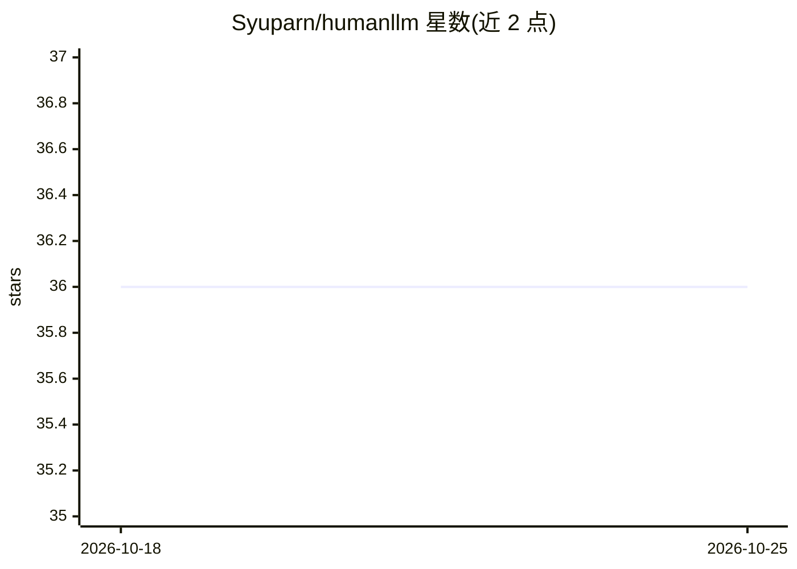

# Syuparn/humanllm

⭐ 36 · TypeScript · MIT · 推送 2026-06-28 · [GitHub](https://github.com/Syuparn/humanllm) · 个人维护

**由人肉回答的 OpenAI API 兼容 LLM 端点**

在本地启动 UI 与 API 服务器（npm run dev），对外暴露 http://localhost:3000/v1 的 OpenAI 兼容接口；聊天应用或 agent 发送请求后，用户在 UI（http://localhost:5173/）上阅读请求并手动输入回答，回答经接口返回给调用方。README 给出从 Codex 调用的示例：配置 ~/.codex/humanllm.config.toml 指定 model_provider 为 humanllm 后用 codex --profile humanllm 调用。依赖 Node.js，主题标签含 joke。

## 筛选速览

| 维度 | 判定 | 备注 |
|---|---|---|
| AI 角色 | `ai-ecosystem` | LLM/agent 周边工具 |
| 许可风险 | `permissive` | MIT |
| 部署形态 | `None` |  |
| 模型依赖 | — | README 未给出锁定关系 |
| 硬件要求 | — | 无带数字的原话,不猜 |
| 安装摩擦 | `low` | 无编译、无系统依赖或容器化 |
| 成熟度 | — | 结构信号不足 |

## 能力要点

- 提供 OpenAI 兼容的 /v1 端点
- 人在 UI 中阅读请求并手动作答
- 附 Codex 调用配置示例

## 适用场景

- 测试聊天应用或 agent 在自定义 OpenAI 兼容后端下的行为
- 以人工回答替代模型观察 agent 的交互流程

## 场景标签

 · 领域:LLM 基础设施/API 模拟

## 证据(README 行号)

> L2: OpenAI API-compatible LLM powered by YOU
> L10: 1. Register OpenAI API compatible endpoint `http://localhost:3000/v1` to your chat app or agent

## 星数曲线

2026-10-18 36 → 2026-10-25 36（+0）

---
*卡片 v1 · prompt 1.4 · 生成 2026-10-25 · 置信度 high · 依据 README sha `5d2770465565` · [字段定义](../../DATASET.md)*
