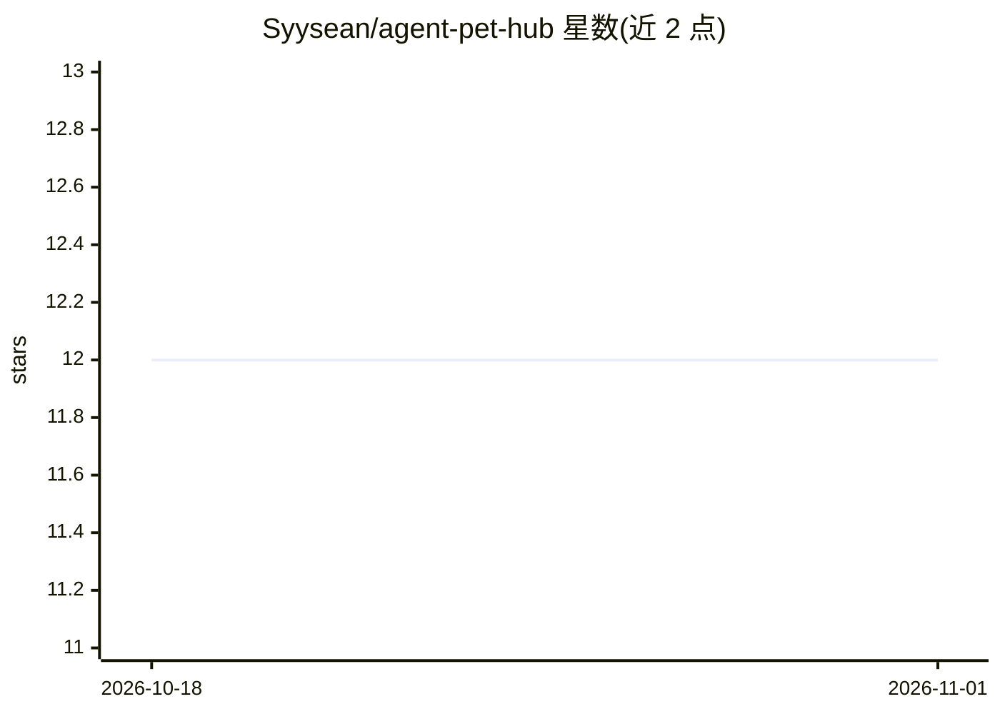

# Syysean/agent-pet-hub

⭐ 12 · Rust · MIT · 推送 2026-06-15 · [GitHub](https://github.com/Syysean/agent-pet-hub) · 个人维护 · 中文 README

**把 AI Agent 运行状态实时可视化为桌面宠物动画的应用**

基于 Tauri 2.x + Rust + React 的跨平台桌面宠物应用：通过适配器层读取 AI Agent（Pi、Hermes、OpenClaw，可扩展至 Claude Code、Gemini CLI、Cursor 等）的运行时事件（如 JSONL 日志），将事件归一化为统一协议后，经事件总线与状态机（31 条转换规则、500ms 防抖）映射为 8 种宠物动画状态。支持 PNG/SVG 皮肤与用户自定义皮肤、系统托盘、跨平台 TTS 语音、以及端口 8765 的 WebSocket IPC 供外部进程订阅事件。需从源码构建。

## 筛选速览

| 维度 | 判定 | 备注 |
|---|---|---|
| AI 角色 | `ai-ecosystem` | LLM/agent 周边工具 |
| 许可风险 | `permissive` | MIT |
| 部署形态 | `library` | 以包/库形式分发 |
| 模型依赖 | — | README 未给出锁定关系 |
| 硬件要求 | — | 无带数字的原话,不猜 |
| 安装摩擦 | `low` | 无编译、无系统依赖或容器化 |
| 成熟度 | `idea` | |

## 能力要点

- 适配器模式接入 Pi/Hermes/OpenClaw 等 Agent，事件归一化为统一协议
- 31 条转换规则的状态机 + 500ms 防抖，将 22 种事件映射为 8 种宠物状态
- PNG/SVG 皮肤系统 + 用户自定义皮肤目录
- WebSocket IPC（端口 8765，Bearer token 鉴权）供外部进程订阅

## 适用场景

- 写代码时通过桌面宠物动画实时看到 Agent 在思考/执行工具/等待审批
- 用 WebSocket 接入自有程序并接收 Agent 状态事件
- 自定义皮肤宠物形象展示 Agent 状态

## 场景标签

 · 领域:开发者工具/Agent 运行时可视化

## 证据(README 行号)

> L11: Agent Pet Hub is a cross-platform desktop pet application built on **Tauri 2.x**. It monitors AI Agent runtime even
> L21: |🎭 **Multi-Agent Support**|Pi Agent, Hermes, OpenClaw — extensible to Claude Code, Gemini CLI, Cursor etc.|

## 星数曲线

2026-10-18 12 → 2026-11-01 12（+0）

---
*卡片 v1 · prompt 1.4 · 生成 2026-11-01 · 置信度 mid · 依据 README sha `35bce77a5cb4` · [字段定义](../../DATASET.md)*
