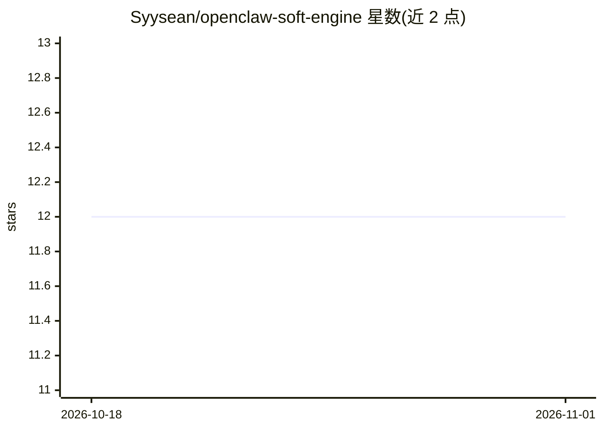

# Syysean/openclaw-soft-engine

⭐ 12 · JavaScript · MIT · 推送 2026-05-22 · [GitHub](https://github.com/Syysean/openclaw-soft-engine) · [官网](https://syysean.github.io/openclaw-soft-engine/) · 个人维护 · 中文 README

**OpenClaw 的生产化部署模板：多专家模型路由与执行加固层**

面向生产或半生产环境部署 OpenClaw 的模板与增强层（非官方发行版）：以 DAG 任务协议（PLAN/CHECKPOINT）替换线性提示流，按负载类型自动路由到 DeepSeek-V3.2/R1 与 Qwen 系列专家模型，并为文本/工具/视觉/推理/代码/嵌入各路由分配独立 API key 以隔离限速冲突。附带跨模态数据清洗、512MB 容器内存上限、45 秒工具超时等资源护栏。通过 Docker Compose 在 Windows 11 + WSL2 环境部署，共 10 步操作指南与 13 项故障排查。

## 筛选速览

| 维度 | 判定 | 备注 |
|---|---|---|
| AI 角色 | `ai-ecosystem` | LLM/agent 周边工具 |
| 许可风险 | `permissive` | MIT |
| 部署形态 | `self-host` | docker 或自建部署 |
| 模型依赖 | locked-api |  |
| 硬件要求 | — | 无带数字的原话,不猜 |
| 安装摩擦 | `low` | 无编译、无系统依赖或容器化 |
| 成熟度 | — | 结构信号不足 |

## 能力要点

- 按负载类型的自动多专家路由（DeepSeek-V3.2/R1 + Qwen 系列）
- 六条路由的独立 API key 池隔离，单 key 泄露可独立吊销
- 跨模态数据清洗：发往纯文本模型的请求自动剥离图像数据
- 容器 512MB 内存硬限与 45 秒工具超时的资源护栏

## 适用场景

- 在 Windows 11 + Docker 上把 OpenClaw 部署到生产或半生产环境
- 多模型并发任务下隔离各路由的 API key 与限速
- 排查 OpenClaw 网关部署中的容器、网络与认证问题

## 场景标签

`模型网关` · 领域:Agent 开发

## 证据(README 行号)

> L14: > **Note:** This project is a deployment template and enhancement layer for OpenClaw. It is not the official OpenCl
> L16: OpenClaw Soft Engine is a production-oriented execution layer that upgrades OpenClaw with structured routing, multi
> L39: - Developers deploying OpenClaw in production or semi-production environments

## 星数曲线

2026-10-18 12 → 2026-11-01 12（+0）

---
*卡片 v1 · prompt 1.4 · 生成 2026-11-01 · 置信度 high · 依据 README sha `934544f89ae1` · [字段定义](../../DATASET.md)*
