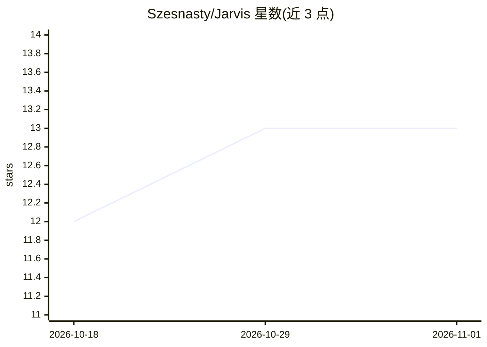

# Szesnasty/Jarvis

⭐ 13 · Python · Apache-2.0 · 推送 2026-09-16 · [GitHub](https://github.com/Szesnasty/Jarvis) · 组织维护

**本地优先的个人知识系统：把笔记、文件与 AI 对话变成持久记忆**

本地优先的 AI 工作区：导入笔记、文件、URL 和 YouTube 内容到 Markdown 记忆库，通过 BM25+语义+知识图谱混合检索，结合本地或云端模型推理，并把有用输出回写为笔记、计划与图谱链接。支持 Ollama 全本地运行（7 个预设模型、按硬件推荐），也可接入 Anthropic/OpenAI/Google。内置 MCP 服务器（26 个工具），可作为 Claude Desktop、Cursor 等客户端的本地记忆后端；兼容 Obsidian vault。提供浏览器 UI、专家角色、辩论模式与 DuckDuckGo 网络搜索。需 Node.js 20+ 与 Python 3.12/3.13，从源码克隆安装。

## 筛选速览

| 维度 | 判定 | 备注 |
|---|---|---|
| AI 角色 | `ai-native` | 本体是模型或模型工具 |
| 许可风险 | `permissive` | Apache-2.0 |
| 部署形态 | `None` |  |
| 模型依赖 | local-ok | 支持本地模型 |
| 硬件要求 | — | 无带数字的原话,不猜 |
| 安装摩擦 | `low` | 无编译、无系统依赖或容器化 |
| 成熟度 | — | 结构信号不足 |

## 能力要点

- BM25+语义嵌入+知识图谱的混合检索，检索步骤本地运行
- 本地模式经 Ollama 运行 7 个预设模型，无需 API key
- 内置 MCP 服务器提供 26 个工具，供外部 AI 客户端用作共享记忆
- 记忆为本地 Markdown，兼容 Obsidian vault

## 适用场景

- 把散落的笔记、文件和研究链接整合为可检索的个人记忆
- 基于自己的知识库提问并获得有出处的回答与计划
- 让 Claude Desktop、Cursor 等 AI 工具共享同一份本地记忆

## 场景标签

`AI 助手` `知识库管理` `RAG` `Agent 记忆` · 领域:Agent 开发

## 证据(README 行号)

> L10: **An AI workspace that remembers what matters.**
> L30: Jarvis is a local-first personal knowledge system that retrieves from your notes, reasons with AI, and writes usefu
> L238: ### 1. One command — everything handled

## 星数曲线

2026-10-18 12 → 2026-11-01 13（+1）

---
*卡片 v1 · prompt 1.4 · 生成 2026-10-31 · 置信度 high · 依据 README sha `65364eb2c105` · [字段定义](../../DATASET.md)*
