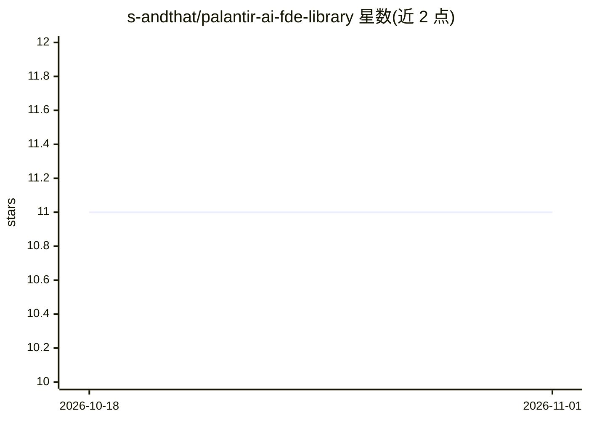

# s-andthat/palantir-ai-fde-library

⭐ 11 · MIT · 推送 2026-03-16 · [GitHub](https://github.com/s-andthat/palantir-ai-fde-library) · 个人维护

**面向 Palantir AI FDE 的社区提示词与 agent 架构参考库**

社区维护的提示词、技能与 agent 参考库，服务 Palantir Foundry 中已 GA 的 AI FDE 自主 agent。内容以『Operator Framing』提示词规范（动作动词+资源类型+规格+输出目标+分支名）为核心，附技能注册表、按五类用户角色（人类 FDE、数据工程师、本体负责人、应用开发者、平台管理员）标注的提示词目录、基础设施使用守则与社区基准数据。文档面向 Foundry + AIP 用户，MIT 许可，接受社区贡献。

## 筛选速览

| 维度 | 判定 | 备注 |
|---|---|---|
| AI 角色 | `ai-knowledge` | 知识聚合/清单类 |
| 许可风险 | `permissive` | MIT |
| 部署形态 | `None` |  |
| 模型依赖 | — | README 未给出锁定关系 |
| 硬件要求 | — | 无带数字的原话,不猜 |
| 安装摩擦 | `low` | 无编译、无系统依赖或容器化 |
| 成熟度 | `idea` | |

## 能力要点

- 标准化的 Operator Framing 提示词结构与模板
- 按五类用户角色组织的提示词与 agent 文档目录
- 社区基准参考（如 ERP 迁移 5 个月→5 天的 DevCon 演示数据）
- 技能注册表（skill.md）与基础设施负载守则

## 适用场景

- 编写更确定的 AI FDE 提示词以降低输出波动
- 团队按角色查找数据集成、本体编辑、治理等场景的现成提示词
- 规划 AI FDE 长会话与并行任务的资源调度

## 场景标签

`提示工程` · 领域:Agent 开发

## 证据(README 行号)

> L2: > A community-built prompt, skill, and agent reference for Palantir's AI Forward Deployed Engineer (AI FDE) — genera
> L21: ├── skill.md               ← Atomic capability registry (all AI FDE skills)

## 星数曲线

2026-10-18 11 → 2026-11-01 11（+0）

---
*卡片 v1 · prompt 1.4 · 生成 2026-11-01 · 置信度 high · 依据 README sha `6cbc10061432` · [字段定义](../../DATASET.md)*
