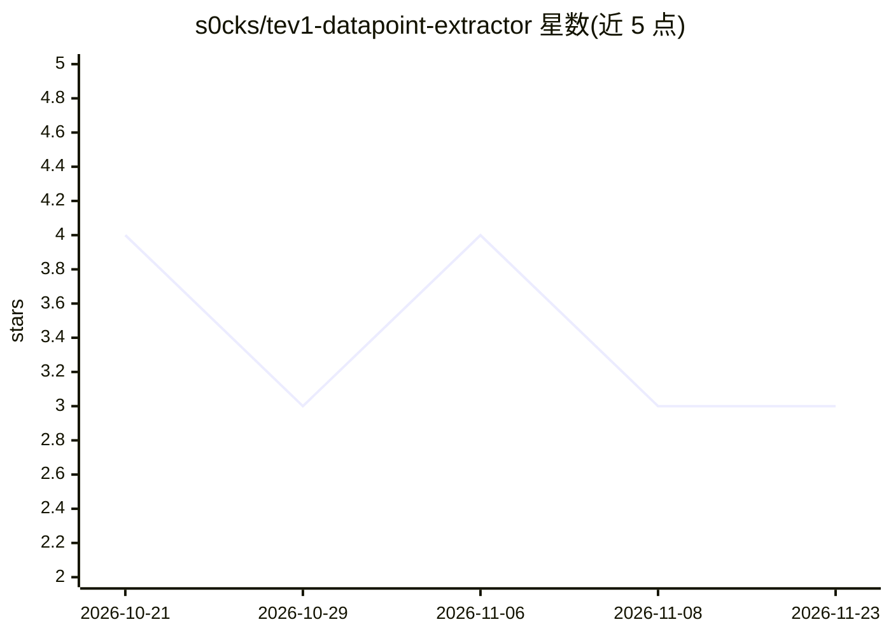

# s0cks/tev1-datapoint-extractor

⭐ 3 · Go · 推送 2026-10-20 · [GitHub](https://github.com/s0cks/tev1-datapoint-extractor) · 个人维护

**将散文段落分类为数据点类型的 Go CLI 工具**

信息图流水线的第一阶段工具：读取上游文本准备工具输出的 segments.json（含纯文本、词性标注与命名实体），通过 Ollama 的 /v1/systemone 接口调用 tev1 决策模型，对每个段落做两次请求（kind 分类与 importance 打分），输出评分后的排序列表。工具本身不做分词或文本分析，也不负责后续的排版、渲染与 QA。带磁盘缓存、preflight 检查与 eval 评估（per-kind precision/recall 与混淆矩阵）。

## 筛选速览

| 维度 | 判定 | 备注 |
|---|---|---|
| AI 角色 | `ai-native` | 本体是模型或模型工具 |
| 许可风险 | `none` | — |
| 部署形态 | `None` |  |
| 模型依赖 | local-ok | 支持本地模型 |
| 硬件要求 | — | 无带数字的原话,不猜 |
| 安装摩擦 | `low` | 无编译、无系统依赖或容器化 |
| 成熟度 | — | 结构信号不足 |

## 能力要点

- 每段两次独立请求（kind 分类 + importance 打分），控制上下文窗口占用
- 磁盘级答案缓存（按模型+问题集哈希+段落文本哈希）
- eval 子命令输出 per-kind precision/recall 与混淆矩阵
- 上下文超限段落标记 context_exceeded/needs_review

## 适用场景

- 为信息图流水线的后续阶段筛选和排序文本段落
- 按 kind 与重要性筛选文本素材
- 在有 Ollama 的机器上重放测试与采集真实 fixtures

## 场景标签

 · 领域:文本处理/流水线工具

## 证据(README 行号)

> L3: Stage 1 of the infographic pipeline. Takes the segments and annotations produced by the
> L6: (via Ollama's `/v1/systemone`) classify and score each one, and writes a ranked list for the later

## 星数曲线

2026-10-21 4 → 2026-11-23 3（-1）

---
*卡片 v1 · prompt 1.4 · 生成 2026-11-21 · 置信度 high · 依据 README sha `a62736548065` · [字段定义](../../DATASET.md)*
