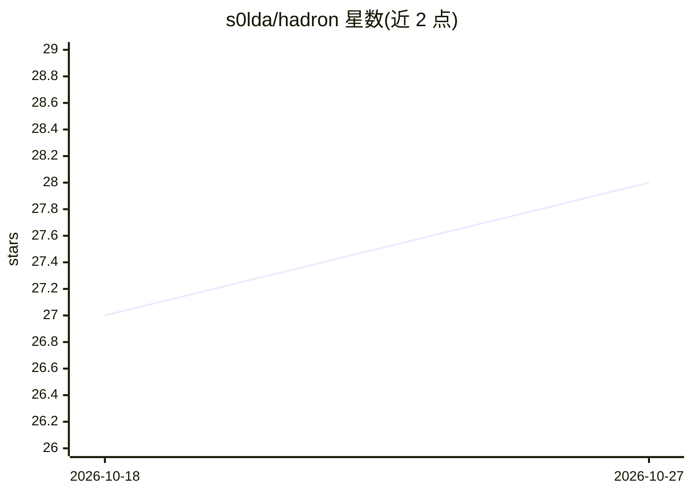

# s0lda/hadron

⭐ 28 · Rust · Apache-2.0 · 推送 2026-10-25 · [GitHub](https://github.com/s0lda/hadron) · 个人维护

**Rust 桌面多智能体编排工作台：统一调度多家 LLM 与 CLI 代理**

用 Rust 编写的原生 GPU 加速桌面应用（GPUI），将 Anthropic、OpenAI、Ollama、OpenRouter、Google Antigravity 及各类编码 CLI 代理接入同一聊天室，代理通过 @mentions 协作并执行并行子任务。代理在隔离 git worktree 中工作，代码经 Merge Gate 自动 rebase 并跑测试后才合入 main；提供跨平台进程沙箱、50+ 内置 MCP 开发工具、跨会话共享记忆、无头 CLI 运行器（hadron run/ci）用于 CI/CD。提供预编译安装脚本与 cargo 源码安装两种方式。

## 筛选速览

| 维度 | 判定 | 备注 |
|---|---|---|
| AI 角色 | `ai-ecosystem` | LLM/agent 周边工具 |
| 许可风险 | `permissive` | Apache-2.0 |
| 部署形态 | `library` | 以包/库形式分发 |
| 模型依赖 | local-ok | 支持本地模型 |
| 硬件要求 | — | 无带数字的原话,不猜 |
| 安装摩擦 | `low` | 无编译、无系统依赖或容器化 |
| 成熟度 | — | 结构信号不足 |

## 能力要点

- 多厂商代理统一编排，@mentions 协作与并行子任务
- git worktree 隔离 + 自动测试的 Merge Gate
- 跨平台原生进程沙箱（Bubblewrap/Seatbelt/PowerShell Job Objects）
- 50+ 内置 MCP 能力与无头 CI 运行器（hadron run / hadron ci）

## 适用场景

- 在同一工作台混用云端与本地模型协作完成编码任务
- 让多个代理在隔离分支并行开发、经测试自动合并
- CI/CD 中以无头模式运行代理群体任务

## 场景标签

`多智能体` `编码 Agent` · 领域:Agent 开发

## 证据(README 行号)

> L17: **Hadron** is a native, GPU-accelerated desktop workspace built in Rust for **orchestrated multi-provider LLM swarm
> L19: Behind the interface, agents (called **Quarks**) execute concurrently over a zero-CPU filesystem event bus (`field.
> L93: - ☁️ **Local & Cloud HTTP Endpoints**: Zero-config connection to local model servers (Ollama, LM Studio) and cloud 

## 星数曲线

2026-10-18 27 → 2026-10-27 28（+1）

---
*卡片 v1 · prompt 1.4 · 生成 2026-10-26 · 置信度 high · 依据 README sha `25d845477a39` · [字段定义](../../DATASET.md)*
