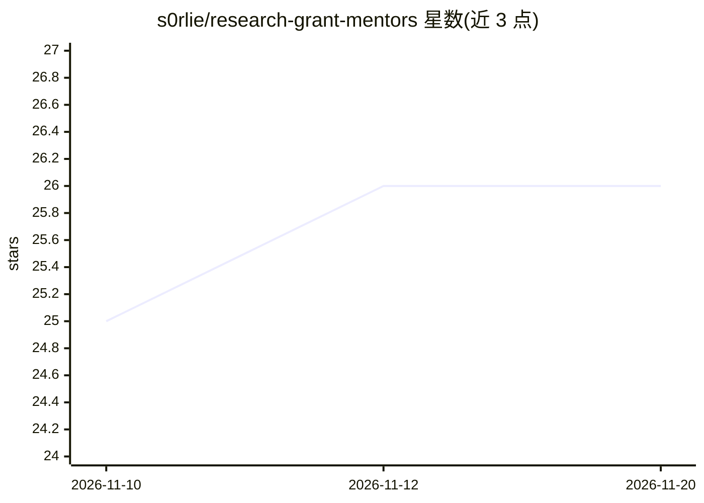

# s0rlie/research-grant-mentors

⭐ 26 · CC-BY-4.0 · 推送 2026-11-09 · [GitHub](https://github.com/s0rlie/research-grant-mentors) · 个人维护

**三套科研基金申请辅导系统提示词（FRIPRO/ERC/MSCA DN）**

面向挪威及欧盟科研项目申请者的系统提示词集合，覆盖 NTNU FRIPRO、ERC Consolidator Grant 与 MSCA Doctoral Networks 三类资助计划。提示词以访谈方式工作：要求用户先用一句话陈述想法，再协助选 call、开发项目描述并按评审标准审阅草稿，不代写正文。资助规则事实写入提示词且不联网检索，各 mentor 标注事实核查日期。优化适配 NTNU IDUN 的 GPT NTNU 服务，也可复制到其他聊天平台自建助手；以 Markdown 提示词文件形式提供，CC BY 4.0 许可。

## 筛选速览

| 维度 | 判定 | 备注 |
|---|---|---|
| AI 角色 | `ai-native` | 本体是模型或模型工具 |
| 许可风险 | `viral` | CC-BY-4.0 |
| 部署形态 | `None` |  |
| 模型依赖 | — | README 未给出锁定关系 |
| 硬件要求 | — | 无带数字的原话,不猜 |
| 安装摩擦 | `low` | 无编译、无系统依赖或容器化 |
| 成熟度 | `idea` | |

## 能力要点

- 访谈式工作流：提问而非代写申请文本
- 覆盖 FRIPRO 四类 call、ERC CoG 与 MSCA DN（后两者为 beta）
- call 事实写入提示词、标注核查日期，不进行网络搜索
- 提供各平台的系统提示词配置步骤与六个对话开场白

## 适用场景

- 准备 FRIPRO/ERC/MSCA 申请时通过问答打磨项目想法
- 按评审标准审阅申请草稿并检查一致性
- 在 NTNU GPT 或自建聊天助手中搭建申请辅导助手

## 场景标签

`提示工程` `科研工具` · 领域:Agent 开发

## 证据(README 行号)

> L2: Interview-based system prompts for developing research grant applications (FRIPRO, the ERC Consolidator Grant and MS
> L44: |**Best for**|Researchers who plan an application to the European Research Council's Consolidator Grant. The mentor

## 星数曲线

2026-11-10 25 → 2026-11-20 26（+1）

---
*卡片 v1 · prompt 1.4 · 生成 2026-11-18 · 置信度 high · 依据 README sha `783f51bdffe7` · [字段定义](../../DATASET.md)*
