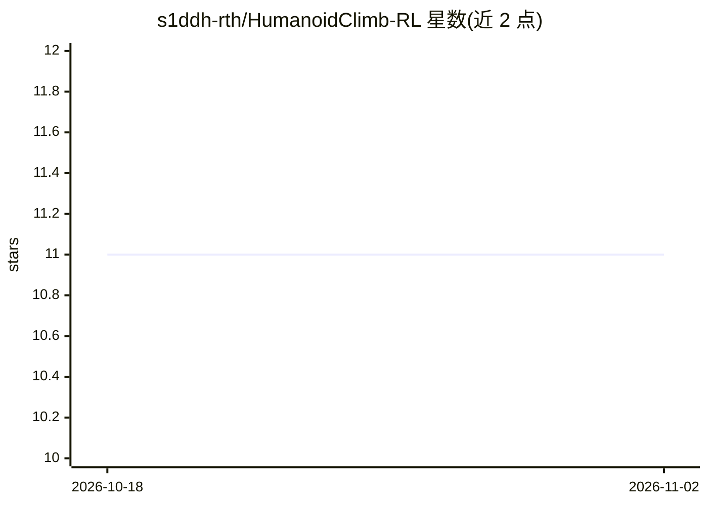

# s1ddh-rth/HumanoidClimb-RL

⭐ 11 · Python · MIT · 推送 2026-04-26 · [GitHub](https://github.com/s1ddh-rth/HumanoidClimb-RL) · 个人维护

**训练人形机器人完成攀岩动态动作的强化学习项目**

包含自定义 OpenAI Gym 环境 HumanoidClimbEnv 与训练脚本，基于 Stable Baselines 3 用 PPO/SAC 算法在 PyBullet 物理仿真中训练人形智能体完成攀岩四肢体转换动作。观测为 306 维（关节姿态/速度、末端距离、支撑状态、接触标志），动作空间可选连续或离散抓握模式，支持多种奖励塑形与事件式抓握奖励，集成 Weights & Biases 实验跟踪。README 声明为进行中工作，论文实验中完整 dyno 转换成功率约 0%。

## 筛选速览

| 维度 | 判定 | 备注 |
|---|---|---|
| AI 角色 | `ai-native` | 本体是模型或模型工具 |
| 许可风险 | `permissive` | MIT |
| 部署形态 | `library` | 以包/库形式分发 |
| 模型依赖 | — | README 未给出锁定关系 |
| 硬件要求 | — | 无带数字的原话,不猜 |
| 安装摩擦 | `low` | 无编译、无系统依赖或容器化 |
| 成熟度 | `idea` | |

## 能力要点

- 自定义 Gym 环境 HumanoidClimbEnv（306 维观测、可选连续/离散动作空间）
- 支持 PPO/SAC 算法，多并行 worker 训练
- 多种奖励塑形函数与事件式抓握信用分配
- 集成 Weights & Biases 实验跟踪

## 适用场景

- 研究人形机器人动态攀岩动作的 RL 训练
- 复现或扩展学位论文中的攀爬实验
- 作为多肢体协调 RL 任务的仿真环境基础

## 场景标签

`强化学习` · 领域:训练与推理

## 证据(README 行号)

> L5: Humanoid Climb is an advanced reinforcement learning project aimed at teaching a humanoid agent to climb vertical su
> L13: - Support for multiple RL algorithms (PPO, SAC)

## 星数曲线

2026-10-18 11 → 2026-11-02 11（+0）

---
*卡片 v1 · prompt 1.4 · 生成 2026-11-01 · 置信度 mid · 依据 README sha `8f3c1124f947` · [字段定义](../../DATASET.md)*
