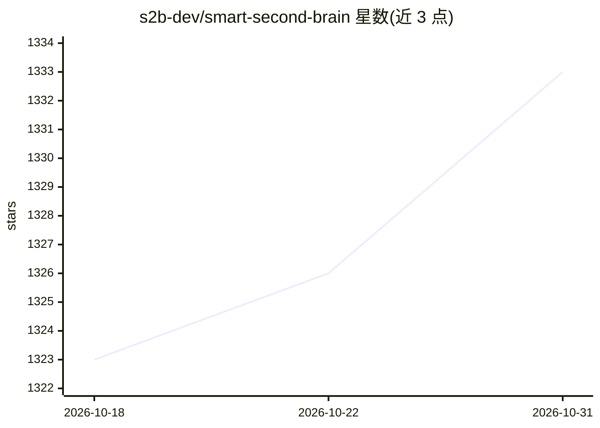

# s2b-dev/smart-second-brain

⭐ 1,333 · TypeScript · MIT · 推送 2026-10-13 · [GitHub](https://github.com/s2b-dev/smart-second-brain) · [官网](https://smartsecondbrain.dev) · 组织维护

**让 Obsidian 笔记库更智能的插件：搜索、知识图谱与 AI 助手**

免费开源的 Obsidian 插件，为个人笔记库提供三部分功能：结合关键词与语义的搜索、把笔记按链接/标签/内容聚成主题的交互式智能图谱、以及可读写笔记、生成图表与面板的 AI Agent（支持技能、记忆、MCP 与其他插件集成）。搜索与图谱无需 AI 提供商即可使用，配置嵌入模型与 AI 提供商后解锁语义搜索与完整 Agent。默认数据不出本机，无遥测，仅每日更新检查可关闭。桌面与移动端均可运行。

## 筛选速览

| 维度 | 判定 | 备注 |
|---|---|---|
| AI 角色 | `ai-enhanced` | 去掉 AI 部分产品仍成立 |
| 许可风险 | `permissive` | MIT |
| 部署形态 | `None` |  |
| 模型依赖 | — | README 未给出锁定关系 |
| 硬件要求 | — | 无带数字的原话,不猜 |
| 安装摩擦 | `low` | 无编译、无系统依赖或容器化 |
| 成熟度 | — | 结构信号不足 |

## 能力要点

- 关键词+语义结合的笔记搜索
- 从链接/标签/内容自动聚类的智能知识图谱
- 可读写笔记、绘制图表面板的 Agent（技能/记忆/MCP/插件集成）
- 本地优先：数据不出本机、无遥测，搜索与图谱无需 AI 提供商

## 适用场景

- 在大量笔记中按含义找到想要的笔记
- 查看笔记库自动归纳出的主题结构
- 通过 AI 助手查询并基于自己的笔记获得回答与编辑建议

## 场景标签

`AI 助手` `知识库管理` `知识图谱` `语义搜索` · 领域:对话与助手

## 证据(README 行号)

> L5: Search surfaces your notes, the graph groups them into the topics your vault is actually about, and the assistant ca
> L15: - **Agents** that read and write your notes, draw charts and dashboards live from them as widgets, with skills, mem

## 星数曲线

2026-10-18 1,323 → 2026-10-31 1,333（+10）

---
*卡片 v1 · prompt 1.4 · 生成 2026-10-21 · 置信度 high · 依据 README sha `85d586ef88d9` · [字段定义](../../DATASET.md)*
