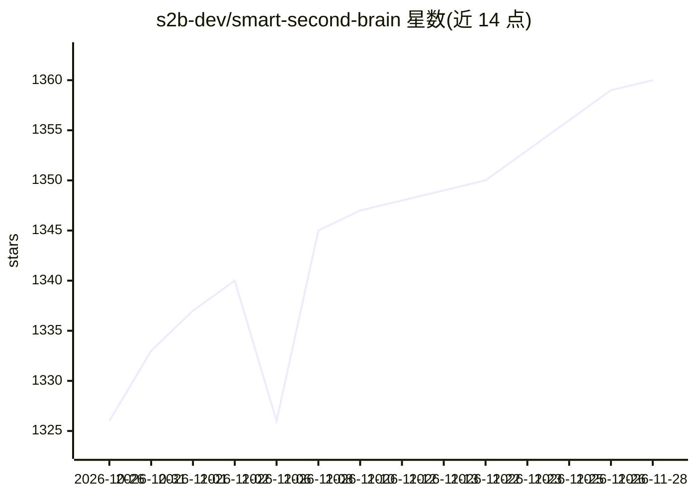

# s2b-dev/smart-second-brain

⭐ 1,360 · TypeScript · MIT · 推送 2026-11-27 · [GitHub](https://github.com/s2b-dev/smart-second-brain) · [官网](https://smartsecondbrain.dev) · 个人维护

**让 Obsidian 笔记库具备语义搜索、智能图谱与 AI 助手的插件**

面向 Obsidian 用户的开源插件：搜索将关键词匹配与语义含义结合；Smart Graph 根据链接、标签与笔记内容自动将笔记按主题分组，无需人工维护；Agent 可读写笔记、从笔记实时生成图表与仪表盘组件，并具备技能、记忆、MCP 及其他插件集成能力。搜索与图谱功能无需配置 AI 提供商即可使用，接入嵌入模型解锁语义搜索，接入 AI 提供商后启用完整 Agent。默认数据不出本机、无遥测，通过 Obsidian 社区插件安装，支持桌面与移动端。

## 筛选速览

| 维度 | 判定 | 备注 |
|---|---|---|
| AI 角色 | `ai-enhanced` | 去掉 AI 部分产品仍成立 |
| 许可风险 | `permissive` | MIT |
| 部署形态 | `None` |  |
| 模型依赖 | — | README 未给出锁定关系 |
| 硬件要求 | — | 无带数字的原话,不猜 |
| 安装摩擦 | `low` | 无编译、无系统依赖或容器化 |
| 成熟度 | — | 结构信号不足 |

## 能力要点

- 关键词匹配与语义含义结合的笔记搜索
- Smart Graph 基于链接、标签与内容自动主题分组，无需维护
- Agent 读写笔记、实时生成图表/仪表盘组件，支持技能、记忆与 MCP
- 默认数据不出本机、无遥测，可关闭每日更新检查

## 适用场景

- 在 Obsidian 笔记库中用语义搜索找到想要的笔记
- 自动生成笔记库的主题知识图谱
- 让 AI 助手读取笔记并起草编辑、绘制笔记数据图表

## 场景标签

`AI 助手` `知识库管理` `知识图谱` `语义搜索` · 领域:对话与助手

## 证据(README 行号)

> L3: Smart Second Brain is a **free**, **open-source** Obsidian plugin that adds better search, an interactive knowledge 
> L5: Search surfaces your notes, the graph groups them into the topics your vault is actually about, and the assistant ca
> L21: Add an embedding model and pick it for search and for the graph to unlock semantic search and topics that read what

## 星数曲线

2026-10-26 1,326 → 2026-11-28 1,360（+34）

---
*卡片 v1 · prompt 1.4 · 生成 2026-11-28 · 置信度 high · 依据 README sha `e493fbd90d8c` · [字段定义](../../DATASET.md)*
