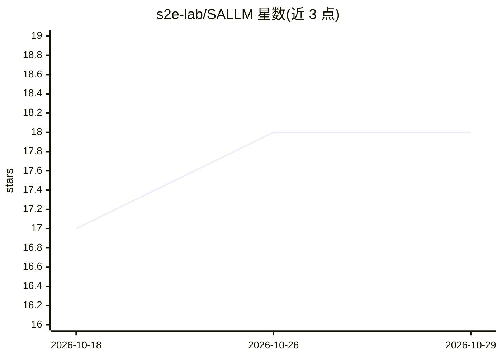

# s2e-lab/SALLM

⭐ 18 · Python · Apache-2.0 · 推送 2026-07-21 · [GitHub](https://github.com/s2e-lab/SALLM) · 组织维护

**评测 LLM 生成代码安全性的基准框架与数据集**

ASE 2024 ASYDE workshop 论文的配套仓库：提供 100 条安全导向的 Python 提示词数据集（含不安全代码样例，已发布到 HuggingFace），用 Transformers 与 OpenAI API 从多个 LLM 生成代码，再通过 Docker 测试与 CodeQL 扫描评估，并用 pass@k 类指标度量模型生成安全代码的能力。面向从事 LLM 代码生成安全评测的科研人员。

## 筛选速览

| 维度 | 判定 | 备注 |
|---|---|---|
| AI 角色 | `ai-ecosystem` | LLM/agent 周边工具 |
| 许可风险 | `permissive` | Apache-2.0 |
| 部署形态 | `None` |  |
| 模型依赖 | — | README 未给出锁定关系 |
| 硬件要求 | — | 无带数字的原话,不猜 |
| 安装摩擦 | `low` | 无编译、无系统依赖或容器化 |
| 成熟度 | — | 结构信号不足 |

## 能力要点

- 100 条安全导向 Python 提示词数据集（JSONL，含 technique/source 字段）
- 支持 Huggingface Transformers 与 OpenAI API 两条代码生成路径
- Docker 测试与 CodeQL 扫描相结合的评估脚本
- pass@k 指标 Notebook

## 适用场景

- 系统评测 LLM 生成安全代码的能力
- 用安全敏感任务数据集补充功能性基准测试
- 复现论文实验或扩展安全代码评测指标

## 场景标签

`模型评测` `网络安全` · 领域:评测与运维

## 证据(README 行号)

> L44: With the growing popularity of Large Language Models (LLMs) in software engineers’ daily practices, it is important
> L34: - `run_tests.py`: python script to run the docker tests for a python code.
> L36: - `codeql_job_runner.py`: python script to run the codeql.

## 星数曲线

2026-10-18 17 → 2026-10-29 18（+1）

---
*卡片 v1 · prompt 1.4 · 生成 2026-10-29 · 置信度 high · 依据 README sha `2cd4de3749d5` · [字段定义](../../DATASET.md)*
