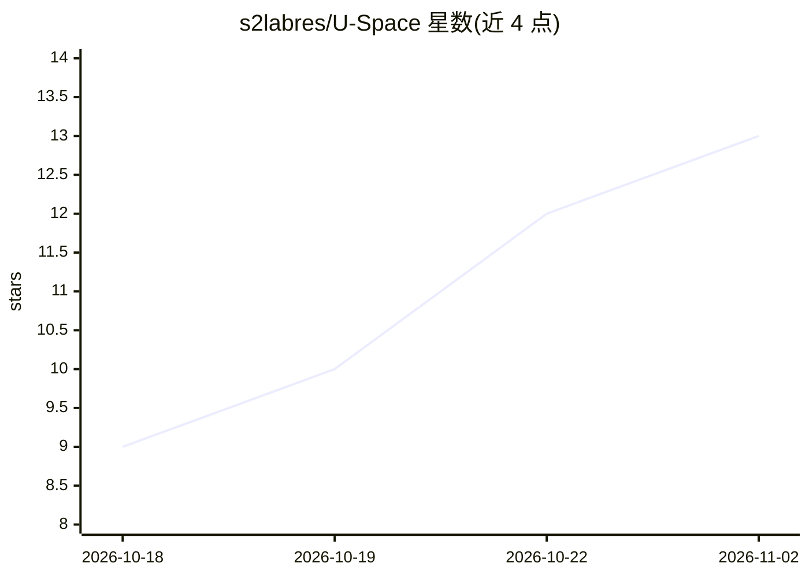

# s2labres/U-Space

⭐ 13 · Python · BSD-3-Clause · 推送 2026-10-19 · [GitHub](https://github.com/s2labres/U-Space) · [官网](http://s2lab.org/U-Space/) · 组织维护

**论文官方代码：语言模型推理中不确定性的可解释追踪**

U-Space 论文的官方实现，面向科研复现：通过语言化信号追踪生成过程中的歧义、信息缺失、证据冲突与一般不确定性，并将该信号与预测熵结合为无需标签、单次前向的 U-Lens 不确定性评分。仓库提供七步 pipeline（采样、生成、标注、前向、构建 U-Space 基、打分、生成表格），在 Gemma-4-31B-it、Qwen3.5-27B、Magistral-Small-2507 三个模型与四个基准上复现论文表格，并实现 A_cone、MSP、预测熵等 9 种对比方法。生成与前向步骤需每模型 1 块 GPU。

## 筛选速览

| 维度 | 判定 | 备注 |
|---|---|---|
| AI 角色 | `ai-ecosystem` | LLM/agent 周边工具 |
| 许可风险 | `permissive` | BSD-3-Clause |
| 部署形态 | `library` | 以包/库形式分发 |
| 模型依赖 | — | README 未给出锁定关系 |
| 硬件要求 | — | 无带数字的原话,不猜 |
| 安装摩擦 | `low` | 无编译、无系统依赖或容器化 |
| 成熟度 | — | 结构信号不足 |

## 能力要点

- 训练无关、可语言化的不确定性追踪信号
- U-Lens：无需标签、单次前向的不确定性评分
- 七步 pipeline 复现论文 Tables 1/2，含 9 种方法实现
- 提供 reproduce 与 smoke 两套配置

## 适用场景

- 复现论文中 U-Lens 与基线方法的实验结果
- 分析语言模型在何处及为何产生不确定性
- 以模块接口扩展新的不确定性评分方法

## 场景标签

`科研工具` · 领域:学习与行业

## 证据(README 行号)

> L3: Official code for **U-Space: Uncovering When and Why Uncertainty Arises in Language Models**.
> L5: U-Space tracks ambiguity, incomplete information, conflicting evidence, and general uncertainty through language-mod
> L9: This repository reproduces U-Lens and the single-pass baselines in Tables 1 and 2 on Gemma-4-31B-it, Qwen3.5-27B, an

## 星数曲线

2026-10-18 9 → 2026-11-02 13（+4）

---
*卡片 v1 · prompt 1.4 · 生成 2026-11-01 · 置信度 high · 依据 README sha `a880ace54cee` · [字段定义](../../DATASET.md)*
