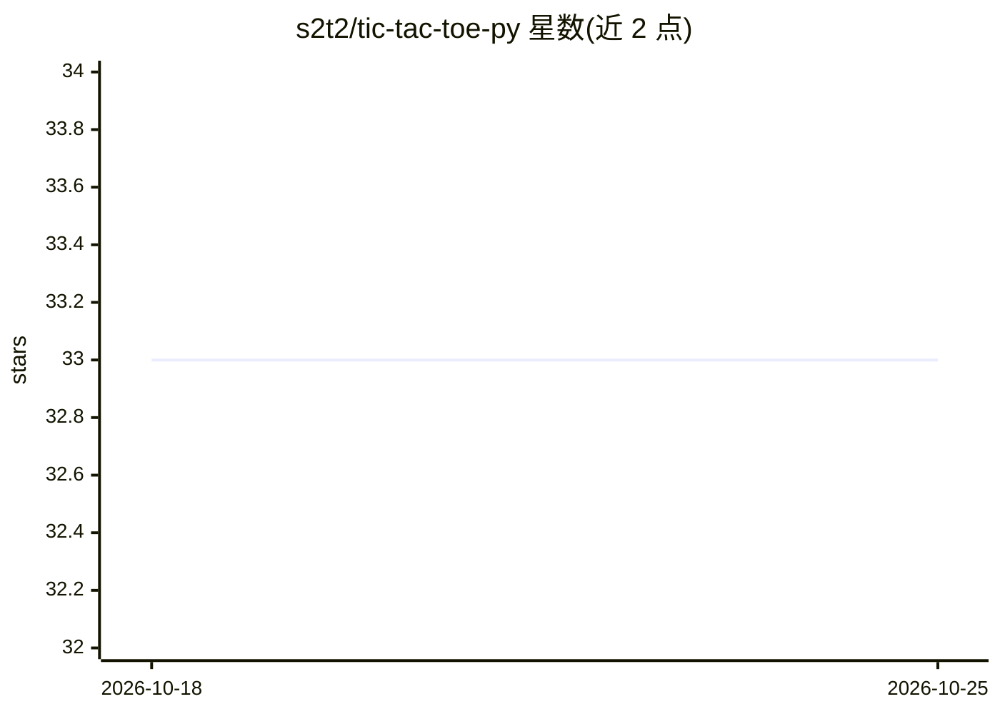

# s2t2/tic-tac-toe-py

⭐ 33 · Python · NOASSERTION · 推送 2025-11-05 · [GitHub](https://github.com/s2t2/tic-tac-toe-py) · 个人维护

**带 minimax AI 对手的井字棋命令行游戏**

Python 编写的井字棋对抗游戏，支持人人、人机、机机对局。电脑玩家提供三种策略：随机选择（EASY）、minimax 算法遍历博弈树做最优选择（HARD，README 称无法被击败）、以及 alpha-beta 剪枝加速版（MINIMAX-AB）。附带批量对局模拟功能，结果保存为 CSV 到 data 目录，并有 pytest 自动化测试。安装方式为 git clone 源码、conda 建虚拟环境后 pip install -r requirements.txt，需 Python 3.7+ 与 Anaconda。

## 筛选速览

| 维度 | 判定 | 备注 |
|---|---|---|
| AI 角色 | `ai-enhanced` | 去掉 AI 部分产品仍成立 |
| 许可风险 | `none` | NOASSERTION |
| 部署形态 | `library` | 以包/库形式分发 |
| 模型依赖 | — | README 未给出锁定关系 |
| 硬件要求 | — | 无带数字的原话,不猜 |
| 安装摩擦 | `low` | 无编译、无系统依赖或容器化 |
| 成熟度 | — | 结构信号不足 |

## 能力要点

- minimax 算法电脑玩家遍历所有博弈状态做最优选择
- alpha-beta 剪枝版本跳过不必要的状态评估以加速
- 批量机机对局模拟并将结果写入 CSV
- 提供 pytest 自动化测试

## 适用场景

- 命令行玩人机或人人井字棋对局
- 批量模拟不同策略电脑玩家的对局结果
- 学习 minimax 与 alpha-beta 剪枝的参考实现

## 场景标签

 · 领域:游戏/算法教学

## 证据(README 行号)

> L3: An adversarial game.
> L49: `COMPUTER-HARD` or `MINIMAX` | A computer player which thinks ahead to make optimal selections. Uses the "minimax" 

## 星数曲线

2026-10-18 33 → 2026-10-25 33（+0）

---
*卡片 v1 · prompt 1.4 · 生成 2026-10-25 · 置信度 high · 依据 README sha `127ad467c36b` · [字段定义](../../DATASET.md)*
