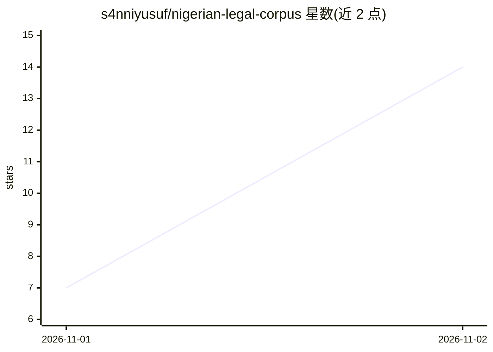

# s4nniyusuf/nigerian-legal-corpus

⭐ 14 · NOASSERTION · 推送 2026-10-16 · [GitHub](https://github.com/s4nniyusuf/nigerian-legal-corpus) · 个人维护

**尼日利亚法律文本语料库：为 RAG 与法律 NLP 提供结构化数据**

由个人维护的尼日利亚法律文本数据集，收录 1999 年宪法、选举法、刑法典及拉各斯租赁法。原始 PDF 保存在 raw/ 目录以保持可溯源，处理后文本以 JSONL 格式存放在 processed/ 目录，每行一条记录，按各法律自身结构划分为 sections、preambles、schedules 等记录类型，schema 因来源而异。面向信息检索、RAG、语义搜索与法律 NLP 研究使用，采用 CC BY 4.0 许可，并声明不替代权威法律来源。

## 筛选速览

| 维度 | 判定 | 备注 |
|---|---|---|
| AI 角色 | `ai-knowledge` | 知识聚合/清单类 |
| 许可风险 | `none` | NOASSERTION |
| 部署形态 | `None` |  |
| 模型依赖 | — | README 未给出锁定关系 |
| 硬件要求 | — | 无带数字的原话,不猜 |
| 安装摩擦 | `low` | 无编译、无系统依赖或容器化 |
| 成熟度 | — | 结构信号不足 |

## 能力要点

- 涵盖宪法、选举法、刑法典、拉各斯租赁法四类法律文本
- raw/ 保留原始 PDF，processed/ 输出 JSONL 结构化记录
- 按各法律结构划分 sections/preambles/schedules 等记录类型
- CC BY 4.0 许可

## 适用场景

- 为法律问答 RAG 系统提供尼日利亚法律的检索语料
- 开展尼日利亚法律文本的 NLP 与语义搜索研究
- 构建可溯源的法律信息检索数据基础

## 场景标签

 · 领域:法律 NLP/数据集

## 证据(README 行号)

> L2: A curated corpus of Nigerian legal texts, including the 1999 Constitution, selected Acts and Lagos tenancy law clean
> L9: |`processed/`|Cleaned and structured text, ready for RAG and NLP use|

## 星数曲线

2026-11-01 7 → 2026-11-02 14（+7）

---
*卡片 v1 · prompt 1.4 · 生成 2026-11-02 · 置信度 high · 依据 README sha `0e955e852d2a` · [字段定义](../../DATASET.md)*
