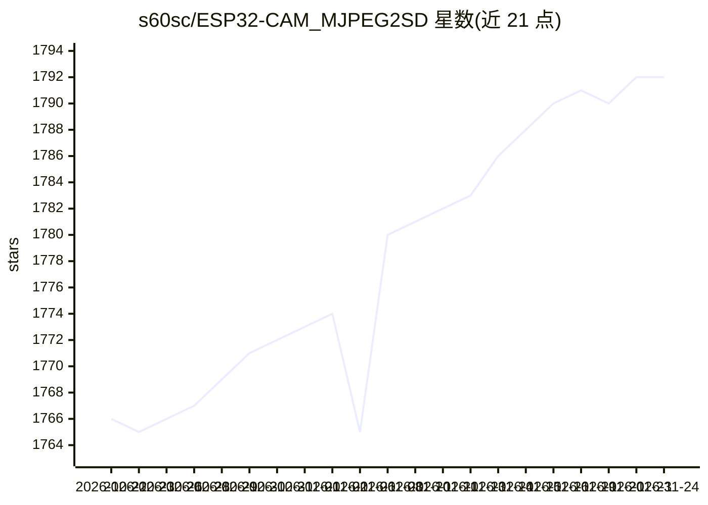

# s60sc/ESP32-CAM_MJPEG2SD

⭐ 1,792 · C++ · AGPL-3.0 · 推送 2026-11-22 · [GitHub](https://github.com/s60sc/ESP32-CAM_MJPEG2SD) · 个人维护

**ESP32 相机应用：移动侦测录 AVI 到 SD 卡并 MJPEG 推流**

运行于 ESP32/ESP32S3 与 OV2640/OV3660/OV5640/PY260 相机的 Arduino 固件应用，将 JPEG 帧合成 AVI 存入 SD 卡，并可通过 MJPEG/RTSP 向浏览器或 NVR 推流。支持相机或 PIR/雷达/加速度计触发的移动侦测、延时与行车记录仪式连续录制、I2S/PDM 麦克风录音、云台舵机与灯光控制、Telegram/Email 告警、FTP/HTTPS/WebDAV 传输及 Home Assistant 集成。经 Arduino IDE 编译烧录，需 PSRAM 启用与指定分区方案；README 提示 ESP32 堆内存不足以支持全部功能。

## 筛选速览

| 维度 | 判定 | 备注 |
|---|---|---|
| AI 角色 | `ai-enhanced` | 去掉 AI 部分产品仍成立 |
| 许可风险 | `viral` | AGPL-3.0 |
| 部署形态 | `None` |  |
| 模型依赖 | — | README 未给出锁定关系 |
| 硬件要求 | — | 无带数字的原话,不猜 |
| 安装摩擦 | `low` | 无编译、无系统依赖或容器化 |
| 成熟度 | — | 结构信号不足 |

## 能力要点

- 移动侦测与连续录制（Time Lapse / DashCam 两种模式）
- AVI 录制可在媒体播放器以正确帧率回放，含音频 WAV 轨
- MQTT 控制并集成 Home Assistant，支持 Telegram/Email 告警
- 提供 Machine Learning 接口与多设备 Camera Hub 功能

## 适用场景

- 搭建安防摄像头，侦测到移动时录像并推送告警
- 野外或火箭飞行监测等场景的长时间录像
- FPV 遥控车辆的摄像头与遥测记录
- 拍摄照片用于 3D 成像的摄影测量

## 场景标签

`图像视频处理` · 领域:感知与多模态

## 证据(README 行号)

> L3: Application for ESP32 / ESP32S3 with OV2640 / OV3660 / OV5640 / PY260 camera to record JPEGs to SD card as AVI files
> L19: * Interface for Machine Learning support.
> L38: The application enables video capture of motion detection or continuous recording. Examples include security camera

## 星数曲线

2026-10-22 1,766 → 2026-11-24 1,792（+26）

---
*卡片 v1 · prompt 1.4 · 生成 2026-11-23 · 置信度 high · 依据 README sha `cb50995bbb36` · [字段定义](../../DATASET.md)*
