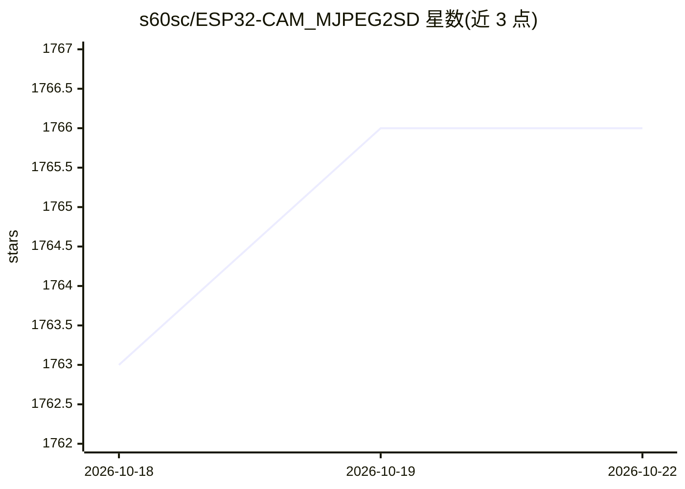

# s60sc/ESP32-CAM_MJPEG2SD

⭐ 1,765 · C++ · AGPL-3.0 · 推送 2026-10-21 · [GitHub](https://github.com/s60sc/ESP32-CAM_MJPEG2SD) · 个人维护

**ESP32 摄像头应用：运动检测录像存 SD 卡并串流到浏览器**

运行于 ESP32/ESP32S3 与 OV2640/OV3660/OV5640/PY260 摄像头的固件应用：将 JPEG 帧录制为 AVI 文件存入 SD 卡，并以 MJPEG 方式回放/串流到浏览器，支持 RTSP 推流。功能包括运动检测（摄像头/PIR/雷达/加速度计）、延时与行车记录仪式连续录制、I2S/PDM 麦克风录音、云台舵机、Telegram/邮件告警、FTP/HTTPS/WebDAV 传输、MQTT 接入 Home Assistant、机器学习接口与摄像头集线器。通过 Arduino IDE 编译烧录，需 arduino-esp32 core v3.1.1 以上；ESP32 因堆内存限制无法启用全部功能，推荐 ESP32S3 板（如 Freenove）以获得更好性能。

## 筛选速览

| 维度 | 判定 | 备注 |
|---|---|---|
| AI 角色 | `ai-enhanced` | 去掉 AI 部分产品仍成立 |
| 许可风险 | `viral` | AGPL-3.0 |
| 部署形态 | `None` |  |
| 模型依赖 | — | README 未给出锁定关系 |
| 硬件要求 | — | 无带数字的原话,不猜 |
| 安装摩擦 | `low` | 无编译、无系统依赖或容器化 |
| 成熟度 | — | 结构信号不足 |

## 能力要点

- 运动检测或连续录制，JPEG 合成 AVI 存 SD 卡，浏览器 MJPEG 回放
- 支持 RTSP 推流、FTP/HTTPS/WebDAV 上传与浏览器下载
- MQTT 控制并可集成 Home Assistant，支持 Telegram/邮件告警
- 提供机器学习支持接口与摄像头集线器功能

## 适用场景

- 用 ESP32-CAM 搭建安防摄像头或野生动物监测
- 行车记录仪式或延时摄影连续录制
- FPV 载具的远程控制与飞行监测
- 接入 Home Assistant 做 MQTT 联动监控

## 场景标签

 · 领域:物联网/嵌入式视频采集

## 证据(README 行号)

> L3: Application for ESP32 / ESP32S3 with OV2640 / OV3660 / OV5640 / PY260 camera to record JPEGs to SD card as AVI files
> L19: * Interface for Machine Learning support.
> L52: The application enables video capture of motion detection or continuous recording. Examples include security camera

## 星数曲线

2026-10-18 1,763 → 2026-10-22 1,766（+3）

---
*卡片 v1 · prompt 1.4 · 生成 2026-10-21 · 置信度 high · 依据 README sha `8302200e9209` · [字段定义](../../DATASET.md)*
