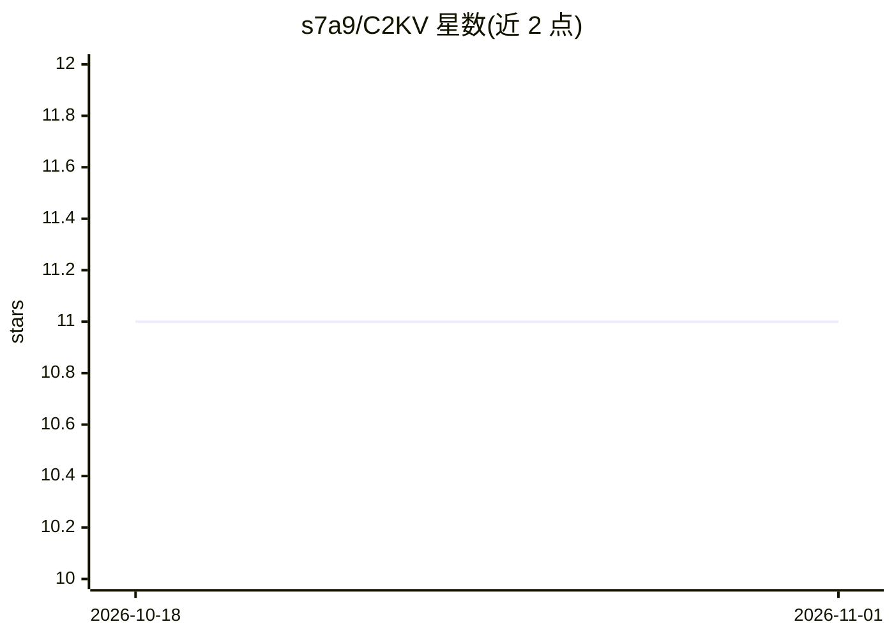

# s7a9/C2KV

⭐ 11 · Python · 推送 2026-08-17 · [GitHub](https://github.com/s7a9/C2KV) · 个人维护

**可拼接压缩 KV Cache 的 LLM 推理复用研究代码**

C2KV 是一种 KV Cache 压缩与复用方法的研究实现：冻结基础模型权重，为每层注意力增加 gist QKV 投影层，将独立预填充的文本片段压缩为记忆槽，并通过 RoPE 重定位使多个压缩缓存可拼接供下游推理使用。代码以 Python 工程形式提供，流程分数据准备、torchrun 分布式训练与 LongBench 评测三步，支持 Llama、Qwen2.5、Qwen3 架构，训练依赖 DeepSpeed ZeRO-3 与 flash-attn，另含 CacheBlend、EPIC 等基线评测脚本。

## 筛选速览

| 维度 | 判定 | 备注 |
|---|---|---|
| AI 角色 | `ai-ecosystem` | LLM/agent 周边工具 |
| 许可风险 | `none` | — |
| 部署形态 | `library` | 以包/库形式分发 |
| 模型依赖 | — | README 未给出锁定关系 |
| 硬件要求 | — | 无带数字的原话,不猜 |
| 安装摩擦 | `low` | 无编译、无系统依赖或容器化 |
| 成熟度 | — | 结构信号不足 |

## 能力要点

- 冻结基础模型，仅训练新增 gist QKV 投影参数
- 压缩比由 gist_type 控制（如 interleave-4 为 4:1，dynamic-interleave 自适应）
- RoPE 重定位使独立预填充的压缩缓存可正确拼接
- 支持 Llama、Qwen2.5、Qwen3 并提供多组基线评测脚本

## 适用场景

- 研究多文档长上下文场景下的 KV Cache 压缩与复用
- 在 LongBench 等基准上复现 C2KV 与基线方法的评测
- 训练自己的 C2KV 压缩模型以降低推理开销

## 场景标签

`模型评测` · 领域:评测与运维

## 证据(README 行号)

> L3: C2KV enables **independently prefilled text segments to be compressed into compact KV Cache representations** that c
> L141: 1. **Freeze base model**: All original model parameters are frozen during training.
> L143: 3. **Interleaved Memory Slots**: Input tokens are divided into chunks. For each chunk, a C2KV memory slot is inser

## 星数曲线

2026-10-18 11 → 2026-11-01 11（+0）

---
*卡片 v1 · prompt 1.4 · 生成 2026-11-01 · 置信度 high · 依据 README sha `0fd73860a6c8` · [字段定义](../../DATASET.md)*
