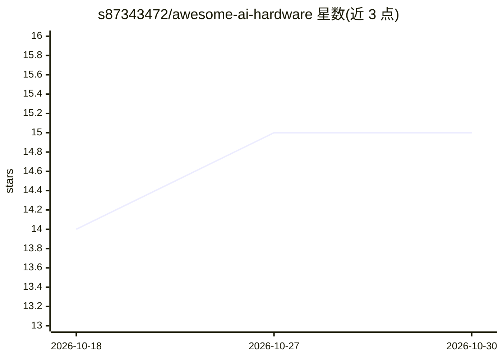

# s87343472/awesome-ai-hardware

⭐ 15 · Python · MIT · 推送 2026-09-12 · [GitHub](https://github.com/s87343472/awesome-ai-hardware) · 个人维护 · 中文 README

**开源 AI 硬件项目策展清单：AI/LLM 与实体硬件结合**

由个人维护的 awesome 类策展清单，收录将大语言模型、agent、语音/视觉 AI 与实体硬件结合的可复现开源项目，按智能家居与 IoT、AI 可穿戴、语音助手、机器人与具身智能、边缘 AI 与微控制器、协议桥接、状态显示硬件等 7 类组织，当前收录 25 个条目。每个条目需满足公开源码、开源许可、硬件交互、文档可复现、可公开验证等 6 项收录标准，维护者可批准标注例外的罕见特例。清单本身不提供安装运行方式，数据存储于 data/projects.json 并有自动字段校验。提供英文与简体中文文档索引及收录时间线。

## 筛选速览

| 维度 | 判定 | 备注 |
|---|---|---|
| AI 角色 | `ai-knowledge` | 知识聚合/清单类 |
| 许可风险 | `permissive` | MIT |
| 部署形态 | `None` |  |
| 模型依赖 | — | README 未给出锁定关系 |
| 硬件要求 | — | 无带数字的原话,不猜 |
| 安装摩擦 | `low` | 无编译、无系统依赖或容器化 |
| 成熟度 | — | 结构信号不足 |

## 能力要点

- 按 7 个类别组织 25 个经评审的开源 AI 硬件项目
- 6 项收录标准：公开源码、开源许可、硬件交互、可复现、可验证等
- 收录数据存于 projects.json/showcases.json，带自动校验
- 保留公开的评审记录与收录/拒绝候选清单

## 适用场景

- 寻找把 LLM/agent 接入机器人、ESP32、智能家居的开源项目
- 按类别浏览边缘 AI 与具身智能的开源实现
- 提交自己符合标准的 AI 硬件项目进入清单

## 场景标签

`精选清单` · 领域:学习与行业

## 证据(README 行号)

> L11: Awesome AI Hardware is a reviewed collection of reproducible projects that bring large language models, agents, spe
> L13: This is not a news feed or an unverified link dump. Every listed project must meet explicit open-source, relevance,
> L31: |No.|Name|License|Description|Image / Video|GitHub|X|

## 星数曲线

2026-10-18 14 → 2026-10-30 15（+1）

---
*卡片 v1 · prompt 1.4 · 生成 2026-10-30 · 置信度 high · 依据 README sha `9ef5c2640d10` · [字段定义](../../DATASET.md)*
