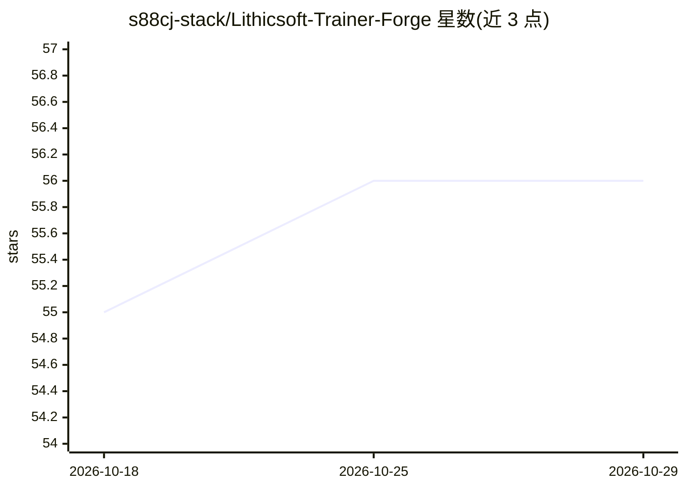

# s88cj-stack/Lithicsoft-Trainer-Forge

⭐ 56 · HTML · 推送 2026-10-28 · [GitHub](https://github.com/s88cj-stack/Lithicsoft-Trainer-Forge) · 组织维护

**模型免疫化训练工具包：训练出难以被侧信道剖析的模型**

面向 Python 强化学习环境的自托管训练工具包，核心是在训练过程中引入受控扰动：梯度扰动引擎、行为多态性（多条功能等价的推理路径）、免疫化调度器、训练后痕迹清理器，并可导出 ONNX/TFLite/CoreML 等 12+ 运行时格式。目标用户是希望模型不被第三方分析或监控工具剖析的工程师。依赖 Python 3.10+ 与 PyTorch/TensorFlow，CUDA 为可选项；通过 forge.toml 配置变异强度，附 Web 仪表盘与基准测试脚本。

## 筛选速览

| 维度 | 判定 | 备注 |
|---|---|---|
| AI 角色 | `ai-ecosystem` | LLM/agent 周边工具 |
| 许可风险 | `none` | — |
| 部署形态 | `None` |  |
| 模型依赖 | — | README 未给出锁定关系 |
| 硬件要求 | — | 无带数字的原话,不猜 |
| 安装摩擦 | `medium` | 含编译或系统依赖之一 |
| 成熟度 | — | 结构信号不足 |

## 能力要点

- 梯度扰动引擎防止权重侧信道外泄
- 行为多态性：生成多条功能等价推理路径
- 免疫化调度器周期性重随机化非关键超参数
- 导出 ONNX/TFLite/CoreML 等 12+ 运行时格式

## 适用场景

- 训练内部模型并降低其被第三方分析工具剖析的风险
- 对模型做防剖析加固后导出到多种部署环境
- 通过 Web 仪表盘监控梯度扰动与免疫化过程

## 场景标签

`模型训练` `网络安全` · 领域:学习与行业

## 证据(README 行号)

> L16: This repository provides a **self-hosted, mutation-aware trainer kit** for Python-based reinforcement learning envi
> L22: |**Gradient Perturbation Engine**|Applies controlled noise to backpropagation paths|Prevents weight-exfiltration vi

## 星数曲线

2026-10-18 55 → 2026-10-29 56（+1）

---
*卡片 v1 · prompt 1.4 · 生成 2026-10-24 · 置信度 mid · 依据 README sha `cd02af5317c3` · [字段定义](../../DATASET.md)*
