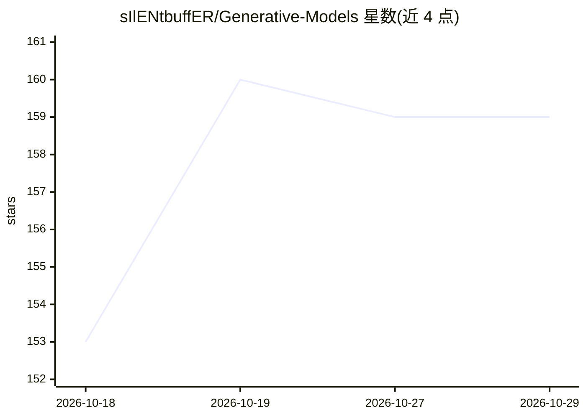

# sIlENtbuffER/Generative-Models

⭐ 159 · C · MIT · 推送 2026-10-06 · [GitHub](https://github.com/sIlENtbuffER/Generative-Models) · 个人维护

**从零实现生成式模型的学习项目：NumPy/C/CUDA 三层实现**

不使用 ML 框架、从第一性原理实现生成式模型的学习项目：路线图覆盖自回归、GAN、VAE、扩散、流模型及收敛方向（VQGAN/VAR/SD3 等），每个模型按递进顺序最多实现三次——NumPy 版关注算法本身、C 版手写张量与内存管理、CUDA 版手写 GPU kernel。以源码仓库形式提供，需 conda 环境；NVIDIA GPU 走 CUDA 工具链，macOS/Linux ARM/无 GPU 路径需系统 C11 编译器，C/CUDA 实现需 CMake+Ninja 编译。附 MNIST/CelebA 数据准备脚本与按论文分组的参考文献。

## 筛选速览

| 维度 | 判定 | 备注 |
|---|---|---|
| AI 角色 | `ai-native` | 本体是模型或模型工具 |
| 许可风险 | `permissive` | MIT |
| 部署形态 | `library` | 以包/库形式分发 |
| 模型依赖 | — | README 未给出锁定关系 |
| 硬件要求 | — | 无带数字的原话,不猜 |
| 安装摩擦 | `high` | 编译与系统依赖俱全 |
| 成熟度 | — | 结构信号不足 |

## 能力要点

- 每个模型最多三次实现：NumPy / C / CUDA 递进对照
- C 版手写张量与内存管理，CUDA 版手写 GPU kernel
- 路线图覆盖 AR/GAN/VAE/Diffusion/Flow 五条主线及收敛方向
- 按论文组织的参考文献（1995-2026）

## 适用场景

- 学习生成式模型的底层算法与实现细节
- 对照阅读同一模型在 NumPy/C/CUDA 三层的差异
- 复现经典论文（DDPM、VAE、Flow Matching 等）的最小实现

## 场景标签

`教程课程` · 领域:学习与行业

## 证据(README 行号)

> L3: A learning project that works through generative models from first principles, no ML frameworks involved. Each model
> L5: 1. **NumPy** (`numpy_impl/`) — get the algorithm itself right
> L6: 2. **C** (`c_impl/`) — hand-written tensors and memory management
> L7: 3. **CUDA** (`cuda_impl/`) — hand-written GPU kernels

## 星数曲线

2026-10-18 153 → 2026-10-29 159（+6）

---
*卡片 v1 · prompt 1.4 · 生成 2026-10-22 · 置信度 mid · 依据 README sha `ba3a75e6f2f4` · [字段定义](../../DATASET.md)*
