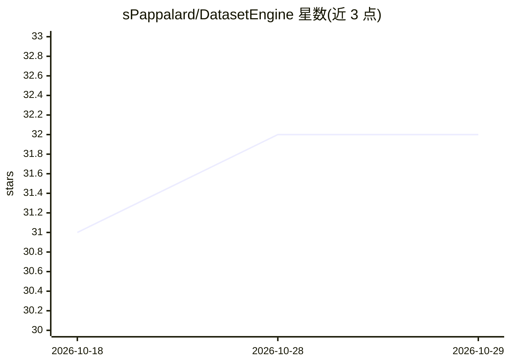

# sPappalard/DatasetEngine

⭐ 32 · JavaScript · MIT · 推送 2026-08-16 · [GitHub](https://github.com/sPappalard/DatasetEngine) · [官网](https://github.com/sPappalard/DatasetEngine) · 个人维护

**本地 GUI 工具：可视化、分析、合并与改进 CV 数据集**

100% 本地运行的目标检测数据集管理工作室，前端 React 18、后端 FastAPI，推理基于 Ultralytics YOLO。含四个模块：Viewer 支持按 split、类别、目标数量与框尺寸深度过滤浏览数据集；Analyzer 提供 MD5 去重、重叠框清理与类别分布统计；Merger 支持多数据集类名映射合并与按比例重切分；Improver 加载用户 best.pt 权重对原始视频推理，标记失败帧并用 Konva.js 画布修正标注后导出训练集。安装需自行启动后端（Python 3.10+）与前端（Node.js 18+）两个服务，无打包的桌面安装程序。

## 筛选速览

| 维度 | 判定 | 备注 |
|---|---|---|
| AI 角色 | `ai-ecosystem` | LLM/agent 周边工具 |
| 许可风险 | `permissive` | MIT |
| 部署形态 | `None` |  |
| 模型依赖 | — | README 未给出锁定关系 |
| 硬件要求 | — | 无带数字的原话,不猜 |
| 安装摩擦 | `low` | 无编译、无系统依赖或容器化 |
| 成熟度 | — | 结构信号不足 |

## 能力要点

- 加载自有 best.pt 权重对视频推理，定位模型失败帧并修正标注（主动学习闭环）
- MD5 去重与重叠边界框一键清理
- 多数据集类名可视化映射合并与自动重切分
- 数据不离开本机的全本地运行

## 适用场景

- 清理含重复图片与重叠标注的杂乱数据集
- 把多个类名冲突的数据集合并成一个训练集
- 用自己训练的 YOLO 权重测视频找盲区并修正标注

## 场景标签

`目标检测` `MLOps` · 领域:感知与多模态

## 证据(README 行号)

> L11:  **An all-in-one local GUI to visualize, analyze, merge, and rapidly improve your Computer Vision datasets.**
> L43: - **Active Learning Loop (Improver):** Test your `.pt` YOLO weights directly on raw videos. The system auto-extract

## 星数曲线

2026-10-18 31 → 2026-10-29 32（+1）

---
*卡片 v1 · prompt 1.4 · 生成 2026-10-26 · 置信度 high · 依据 README sha `96628b632f10` · [字段定义](../../DATASET.md)*
