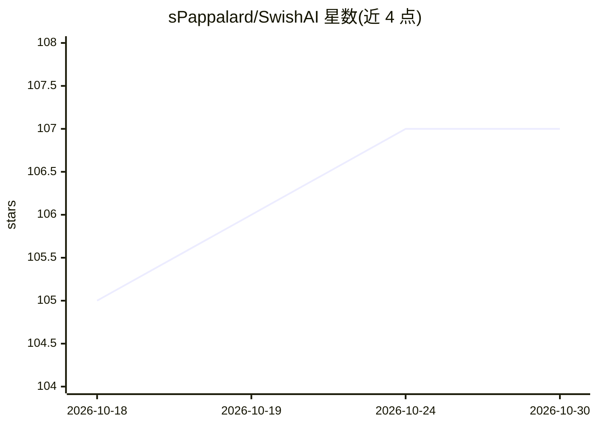

# sPappalard/SwishAI

⭐ 107 · Python · AGPL-3.0 · 推送 2026-08-16 · [GitHub](https://github.com/sPappalard/SwishAI) · 个人维护

**篮球投篮视频分析应用：YOLOv11 检测球员与球并统计命中率**

面向篮球视频的计算机视觉 Web 应用：用户上传 MP4/MOV/AVI 视频，基于自定义训练的 YOLOv11s 模型检测 5 类目标（球、入筐球、球员、篮筐、投篮球员），自动统计出手与命中数并计算命中率 FG%，在输出视频上叠加动态特效与 HUD。技术栈为 FastAPI 后端与 React 前端，需分别启动；运行前需自行训练模型（或使用预训练权重），训练脚本针对 GTX 1060 6GB 级消费级硬件优化。提供三种处理模式与每类置信度阈值调节，采用 AGPL-3.0 许可。

## 筛选速览

| 维度 | 判定 | 备注 |
|---|---|---|
| AI 角色 | `ai-native` | 本体是模型或模型工具 |
| 许可风险 | `viral` | AGPL-3.0 |
| 部署形态 | `library` | 以包/库形式分发 |
| 模型依赖 | — | README 未给出锁定关系 |
| 硬件要求 | — | 无带数字的原话,不猜 |
| 安装摩擦 | `low` | 无编译、无系统依赖或容器化 |
| 成熟度 | — | 结构信号不足 |

## 能力要点

- YOLOv11s 检测 5 类篮球场景目标，统计出手/命中与实时 FG%
- 三种处理模式（完整追踪/仅统计特效/仅统计）与逐类置信度阈值调节
- 物理冷却逻辑（出手 1.5s/入筐 2.0s）防止重复计数
- 训练脚本针对消费级 GPU（GTX 1060 6GB）优化，含 FP16 混合精度训练

## 适用场景

- 上传篮球训练或比赛视频，自动统计投篮命中率
- 生成带检测框、命中特效与统计 HUD 的分析视频
- 针对不同光线与球场环境调节检测置信度阈值

## 场景标签

`目标检测` `图像视频处理` · 领域:感知与多模态

## 证据(README 行号)

> L5: SwishAI is a Computer Vision application designed to analyze basketball shots from video footage automatically. Powe
> L23: - **Advanced Object Detection**: Detects 5 distinct classes: Ball, Ball in Basket, Player, Basket, and Player Shoot
> L24: - **Smart Scoring System**: Automatically counts shots attempted vs. made to calculate real-time Field Goal Percent

## 星数曲线

2026-10-18 105 → 2026-10-30 107（+2）

---
*卡片 v1 · prompt 1.4 · 生成 2026-10-23 · 置信度 high · 依据 README sha `c518c431a954` · [字段定义](../../DATASET.md)*
