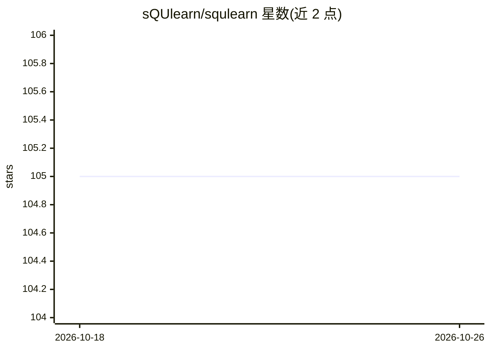

# sQUlearn/squlearn

⭐ 105 · Python · Apache-2.0 · 推送 2026-06-12 · [GitHub](https://github.com/sQUlearn/squlearn) · [官网](https://squlearn.github.io) · 组织维护

**面向 NISQ 量子机器学习的 Python 库，兼容 scikit-learn 接口**

sQUlearn 是量子机器学习（QML）Python 库，提供与 scikit-learn 兼容的高层接口，覆盖量子核方法、量子神经网络（QNN）与量子储备池计算；底层由 QNN 引擎与量子核引擎构成，executor 可在 PennyLane、Qiskit、Qulacs 的模拟与真实后端上运行实验。双层架构同时服务 QML 研究者与从业者，支持自定义数据编码、自动执行处理与核正则化技术。声明 TRL 1–3，仅限研究与实验用途，不适用于生产部署。需 Python 3.10 以上。

## 筛选速览

| 维度 | 判定 | 备注 |
|---|---|---|
| AI 角色 | `ai-native` | 本体是模型或模型工具 |
| 许可风险 | `permissive` | Apache-2.0 |
| 部署形态 | `library` | 以包/库形式分发 |
| 模型依赖 | — | README 未给出锁定关系 |
| 硬件要求 | — | 无带数字的原话,不猜 |
| 安装摩擦 | `low` | 无编译、无系统依赖或容器化 |
| 成熟度 | `idea` | |

## 能力要点

- 量子核方法与量子神经网络（QNN）工具集，兼容 scikit-learn 高层接口
- 支持 PennyLane、Qiskit、Qulacs 的模拟与真实后端执行
- 自定义数据编码策略、自动执行处理与核正则化
- 覆盖量子储备池计算（quantum reservoir computing）

## 适用场景

- 在 scikit-learn 流水线中试验量子核方法或 QNN 模型
- QML 研究者做原型设计与实验对比
- 在真实量子硬件后端上运行机器学习实验

## 场景标签

`科研工具` · 领域:学习与行业

## 证据(README 行号)

> L3: sQUlearn is a user-friendly, NISQ-ready Python library for quantum machine learning (QML), designed for seamless int
> L5: sQUlearn offers scikit-learn compatible high-level interfaces for various kernel methods, QNNs and quantum reservoir

## 星数曲线

2026-10-18 105 → 2026-10-26 105（+0）

---
*卡片 v1 · prompt 1.4 · 生成 2026-10-23 · 置信度 high · 依据 README sha `449041af0e66` · [字段定义](../../DATASET.md)*
