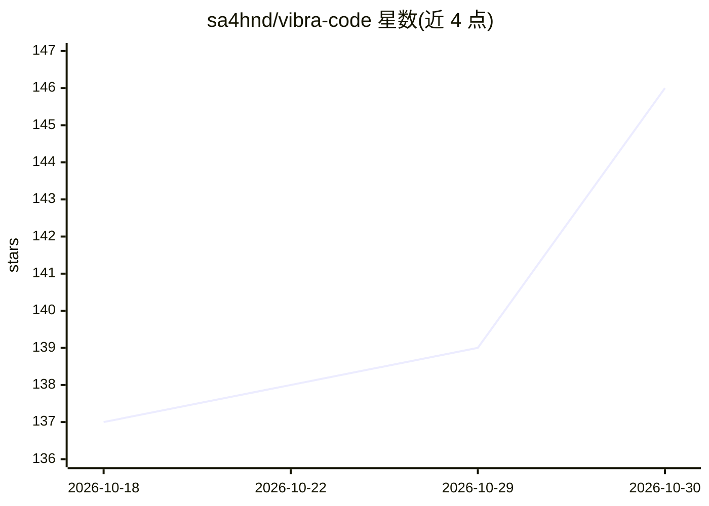

# sa4hnd/vibra-code

⭐ 146 · TypeScript · AGPL-3.0 · 推送 2026-03-06 · [GitHub](https://github.com/sa4hnd/vibra-code) · [官网](https://mintlify.wiki/sa4hnd/vibra-code) · 个人维护

**开源 AI 移动应用生成器：描述需求由 AI 生成 App 并手机预览**

面向终端用户的开源 AI 应用构建器，也是 App Store 同名应用的完整源码。用户用自然语言（支持语音与截图输入）描述想要的应用，后端在 E2B 云沙箱中运行 Claude Code 生成完整应用代码，变更经 Convex 实时同步到手机原生预览。技术栈为 Next.js 15 + Convex + Inngest + React Native/Expo，支持切换 Claude/Cursor/Gemini 供应商，可自托管与二次开发。限制：需多项第三方 API key，移动端构建要求 macOS 与 Xcode。

## 筛选速览

| 维度 | 判定 | 备注 |
|---|---|---|
| AI 角色 | `ai-native` | 本体是模型或模型工具 |
| 许可风险 | `viral` | AGPL-3.0 |
| 部署形态 | `library` | 以包/库形式分发 |
| 模型依赖 | locked-api |  |
| 硬件要求 | — | 无带数字的原话,不猜 |
| 安装摩擦 | `low` | 无编译、无系统依赖或容器化 |
| 成熟度 | — | 结构信号不足 |

## 能力要点

- E2B 云沙箱内运行 Claude Code 实时生成应用代码
- Convex 实时同步，手机端原生预览 web 与移动应用
- 多 AI 供应商（Claude/Cursor/Gemini）一键切换
- Texture + IGListKit 的 60fps 原生聊天 UI，支持语音/图片输入

## 适用场景

- 用一句话描述就生成移动应用并在手机上预览
- 自托管并定制 AI 提示词的 vibe coding 应用
- 把 AI 生成的项目直接推送到 GitHub

## 场景标签

`代码生成` · 领域:编码与开发

## 证据(README 行号)

> L41: Vibra Code is an **open-source AI app builder** that lets you create mobile apps by describing them in plain Englis
> L65: **Multi-AI providers** -- Claude (default), Cursor, Gemini. Switch with one env var.

## 星数曲线

2026-10-18 137 → 2026-10-30 146（+9）

---
*卡片 v1 · prompt 1.4 · 生成 2026-10-22 · 置信度 high · 依据 README sha `883ce146f650` · [字段定义](../../DATASET.md)*
