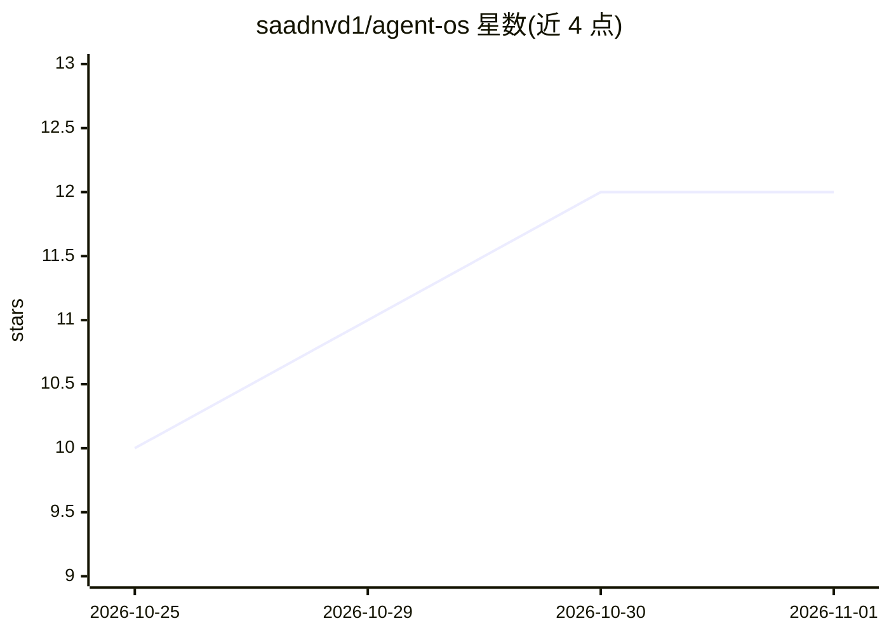

# saadnvd1/agent-os

⭐ 12 · TypeScript · MIT · 推送 2026-10-31 · [GitHub](https://github.com/saadnvd1/agent-os) · [官网](https://runagentos.com) · 个人维护

**自托管的 AI 编码 agent 管理界面：手机端统筹多 agent 会话**

Mobile-first 的 Web UI，用于运行与管理 Claude Code、Codex、OpenCode 等 AI 编码 agent：每个 workspace 配一个 orchestrator 负责发起任务、应答被阻塞的 agent、经门控合并 PR；任务各自使用 worktree/分支/端口并进入优先级队列。提供 git 集成、多窗格终端、全文搜索、iPhone 应用与 runagentos.com 的 Connect 远程访问。需 Node.js 22+、git、tmux 及至少一个 agent CLI；付费 Pro 档为 $4-6/月。

## 筛选速览

| 维度 | 判定 | 备注 |
|---|---|---|
| AI 角色 | `ai-ecosystem` | LLM/agent 周边工具 |
| 许可风险 | `permissive` | MIT |
| 部署形态 | `library` | 以包/库形式分发 |
| 模型依赖 | — | README 未给出锁定关系 |
| 硬件要求 | — | 无带数字的原话,不猜 |
| 安装摩擦 | `low` | 无编译、无系统依赖或容器化 |
| 成熟度 | — | 结构信号不足 |

## 能力要点

- 每 workspace 一个 orchestrator：门控合并 PR、任务队列与跨机器调度
- 任务独立 worktree/分支/端口，结束于 PR 并等待签发
- 支持 Claude Code、Codex、OpenCode 等 agent 并行运行于终端或聊天
- iPhone 应用与 AgentOS Connect 私有地址实现手机远程访问

## 适用场景

- 在手机上查看并操控本机运行的多个 AI 编码 agent 会话
- 让 orchestrator 排队、审查并合并 agent 产出的 PR
- 把多台机器链接起来，按负载分派编码任务

## 场景标签

`编码 Agent` `多智能体` · 领域:Agent 开发

## 证据(README 行号)

> L3: A self-hosted home for your AI coding agents. Run Claude Code, Codex,
> L12: - **An orchestrator for each workspace.** A chat that starts tasks, answers blocked agents, and merges pull request
> L17: - **Built for your phone.** The whole app works on a phone; pair it with a QR code, or get the iPhone app from the 

## 星数曲线

2026-10-25 10 → 2026-11-01 12（+2）

---
*卡片 v1 · prompt 1.4 · 生成 2026-11-01 · 置信度 high · 依据 README sha `7b7b11c74be8` · [字段定义](../../DATASET.md)*
