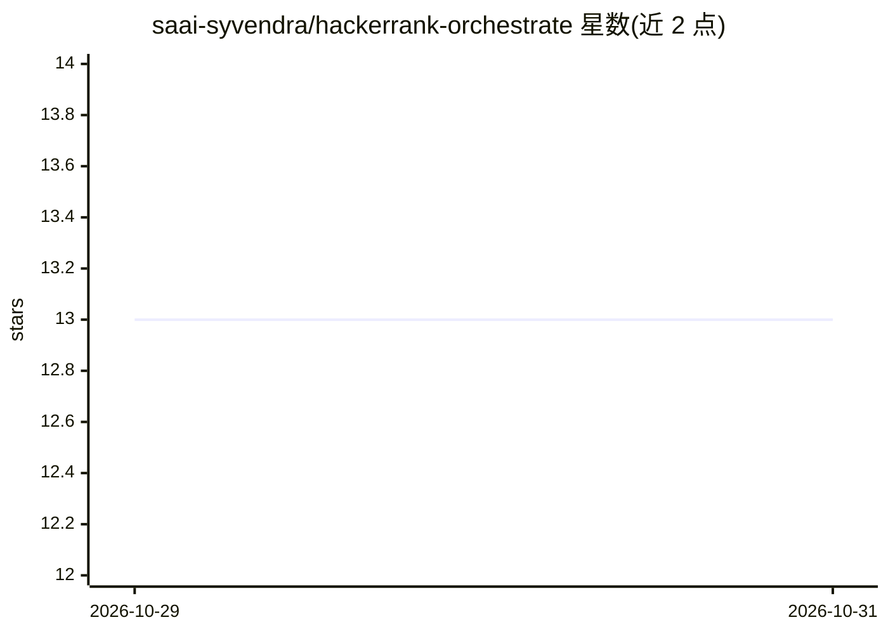

# saai-syvendra/hackerrank-orchestrate

⭐ 13 · Python · 推送 2026-05-25 · [GitHub](https://github.com/saai-syvendra/hackerrank-orchestrate) · [官网](https://saai.syvendra.com/myspace/hackerrank-orchestrate) · 个人维护

**HackerRank Orchestrate 冠军客服工单分诊 agent：检索作答或转人工**

终端运行的 AI agent，读取客服工单后基于限定支持文档库作答（须引用实际打开的文章）或升级转人工。单 agent 单工具：BM25+稠密向量经 RRF 融合、Cohere 重排，LanceDB 本地存储，确定性分块保证可复现。模型前中间件拦截多语言提示注入；post-hoc 守卫将无阅读依据的回答转为升级。Haiku 分流琐细工单，Sonnet 处理需推理的工单。在 HackerRank Orchestrate（2026.5）以 12,885 报名中获第 1。需自备 Anthropic/OpenAI/Cohere API key。

## 筛选速览

| 维度 | 判定 | 备注 |
|---|---|---|
| AI 角色 | `ai-native` | 本体是模型或模型工具 |
| 许可风险 | `none` | — |
| 部署形态 | `library` | 以包/库形式分发 |
| 模型依赖 | locked-api |  |
| 硬件要求 | — | 无带数字的原话,不猜 |
| 安装摩擦 | `low` | 无编译、无系统依赖或容器化 |
| 成熟度 | — | 结构信号不足 |

## 能力要点

- 单 agent 单工具：search/read/grep 三模式检索文档库
- BM25+稠密向量 RRF 融合 + Cohere 重排，LanceDB 本地存储，确定性分块
- 模型前中间件拦截多语言提示注入，引用须实际打开文件
- Haiku 分流琐细工单 + Sonnet 处理复杂工单的两级模型策略

## 适用场景

- 在限定语料内回答客服工单并给出可核验引用
- 对超出语料或敏感工单自动升级转人工
- 拦截工单中的提示注入尝试

## 场景标签

`文档问答` · 领域:知识与检索

## 证据(README 行号)

> L20: either **answer it** — grounded _only_ in the provided corpus, with a citation to
> L94: Claude Sonnet 4.6 (agent) + Haiku 4.5 (classifier) · LangChain `create_agent` ·

## 星数曲线

2026-10-29 13 → 2026-10-31 13（+0）

---
*卡片 v1 · prompt 1.4 · 生成 2026-10-31 · 置信度 high · 依据 README sha `a776e6349ae3` · [字段定义](../../DATASET.md)*
