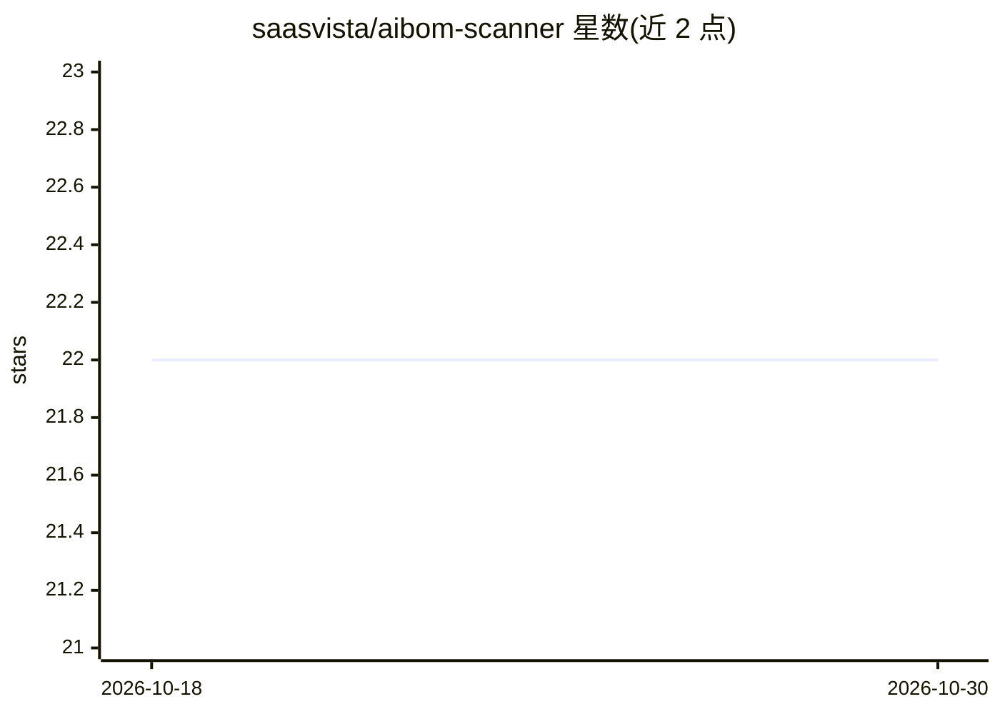

# saasvista/aibom-scanner

⭐ 22 · Python · Apache-2.0 · 推送 2026-10-24 · [GitHub](https://github.com/saasvista/aibom-scanner) · [官网](https://pypi.org/project/aibom-scanner/) · 组织维护

**扫描代码库生成 AI 物料清单（AIBOM）并映射合规风险的工具**

面向开发与合规团队的静态扫描 CLI：读取代码库，列出其中的 AI SDK 调用、模型、MCP server 与 agent 工具，生成 AI 物料清单（AIBOM），并将风险发现映射到 NIST AI RMF、ISO 42001、EU AI Act 及 OWASP LLM/Agentic Top 10。纯 Python stdlib 实现、零依赖，不做网络调用、不使用语言模型；不存储 MCP 配置中的值，对密钥形状字符串做脱敏。每次扫描报告自身覆盖率，未能解析的语言会显式标出而非视为干净。输出 table/JSON/SARIF 三种格式，带退出码门禁，可集成 GitHub Action。

## 筛选速览

| 维度 | 判定 | 备注 |
|---|---|---|
| AI 角色 | `ai-ecosystem` | LLM/agent 周边工具 |
| 许可风险 | `permissive` | Apache-2.0 |
| 部署形态 | `self-host` | docker 或自建部署 |
| 模型依赖 | — | README 未给出锁定关系 |
| 硬件要求 | — | 无带数字的原话,不猜 |
| 安装摩擦 | `low` | 无编译、无系统依赖或容器化 |
| 成熟度 | — | 结构信号不足 |

## 能力要点

- 70 种检测模式，覆盖 8 种语言的 AI SDK 与依赖清单
- MCP server 清单：来源文件、transport、版本是否固定，值脱敏
- 约 500 个 LangChain/CrewAI 工具按能力分类，三要素组合触发 HIGH 发现
- 映射 NIST AI RMF/ISO 42001/EU AI Act 共 49 项控制与 20 项 OWASP 条目

## 适用场景

- 盘点仓库里用了哪些 AI SDK、模型和 agent 工具
- 在 CI 中对每个 PR 做 AI 合规扫描并设门禁
- 排查 agent 同时具备不可信输入、敏感数据访问与外部行动能力的提示注入风险组合
- 生成对接合规框架的 AIBOM 报告（JSON/SARIF）

## 场景标签

`网络安全` · 领域:学习与行业

## 证据(README 行号)

> L13: `aibom-scanner` reads a codebase and writes an AI Bill of Materials (AIBOM). It lists every AI SDK and model the co
> L71: `aibom-scanner` detects AI SDKs in your codebase and generates an **AI Bill of Materials (AIBOM)** with compliance 
> L183: ```bash

## 星数曲线



2026-10-18 22 → 2026-10-30 22（+0）


---
*卡片 v1 · prompt 1.4 · 生成 2026-10-27 · 置信度 mid · 依据 README sha `184e40188eec` · [字段定义](../../DATASET.md)*
