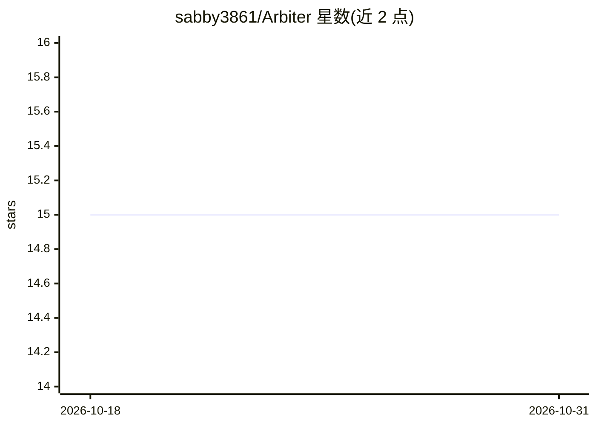

# sabby3861/Arbiter

⭐ 15 · Swift · MIT · 推送 2026-09-03 · [GitHub](https://github.com/sabby3861/Arbiter) · 个人维护

**Swift 统一 AI 运行时：单一接口接入多家云与本地模型并智能路由**

面向 Swift/iOS/macOS 开发者的统一 AI 运行时框架：用一套接口调用 Anthropic、OpenAI、Gemini、Ollama、Apple Foundation Models、MLX 等云端与本地模型，支持流式输出、会话管理、结构化输出（基于 Codable 派生 JSON Schema）、工具执行（含人工审批）与失败回退。核心机制是智能路由：对每个请求做复杂度分类、任务检测与成本估计，按能力/质量/延迟/隐私/成本等因素打分选提供商，并根据历史表现自适应调整，还提供隐私分级路由、预算控制、重试与超时配置。以 Swift Package Manager 集成。

## 筛选速览

| 维度 | 判定 | 备注 |
|---|---|---|
| AI 角色 | `ai-ecosystem` | LLM/agent 周边工具 |
| 许可风险 | `permissive` | MIT |
| 部署形态 | `None` |  |
| 模型依赖 | local-ok | 支持本地模型 |
| 硬件要求 | — | 无带数字的原话,不猜 |
| 安装摩擦 | `low` | 无编译、无系统依赖或容器化 |
| 成熟度 | — | 结构信号不足 |

## 能力要点

- 单一接口接入云端（Anthropic/OpenAI/Gemini 等）与本地（Ollama/MLX/Apple FM）模型
- 智能路由：请求复杂度/任务分析 + 七因素评分 + 自适应性能追踪
- 隐私路由：内置敏感数据分层检测（Luhn 校验、NSDataDetector、NLTagger）与 .strict 失败关闭模式
- 工具执行含人工审批（requiresApproval）、超时与并发控制；结构化输出由 Codable 派生 JSON Schema

## 适用场景

- iOS/macOS 应用中接入多家 AI 提供商并按成本/隐私/延迟自动选路
- 含敏感数据的请求强制走端上模型（Apple FM/MLX）
- 统一管理多提供商的预算、重试与故障回退
- 让 Swift 应用获得带审批环节的工具调用能力

## 场景标签

`模型网关` · 领域:Agent 开发

## 证据(README 行号)

> L13: Arbiter is a unified AI runtime for Swift that lets you call any AI provider through a single, consistent interface
> L144: ## Intelligent Routing

## 星数曲线

2026-10-18 15 → 2026-10-31 15（+0）

---
*卡片 v1 · prompt 1.4 · 生成 2026-10-30 · 置信度 high · 依据 README sha `3e3bc68737ab` · [字段定义](../../DATASET.md)*
