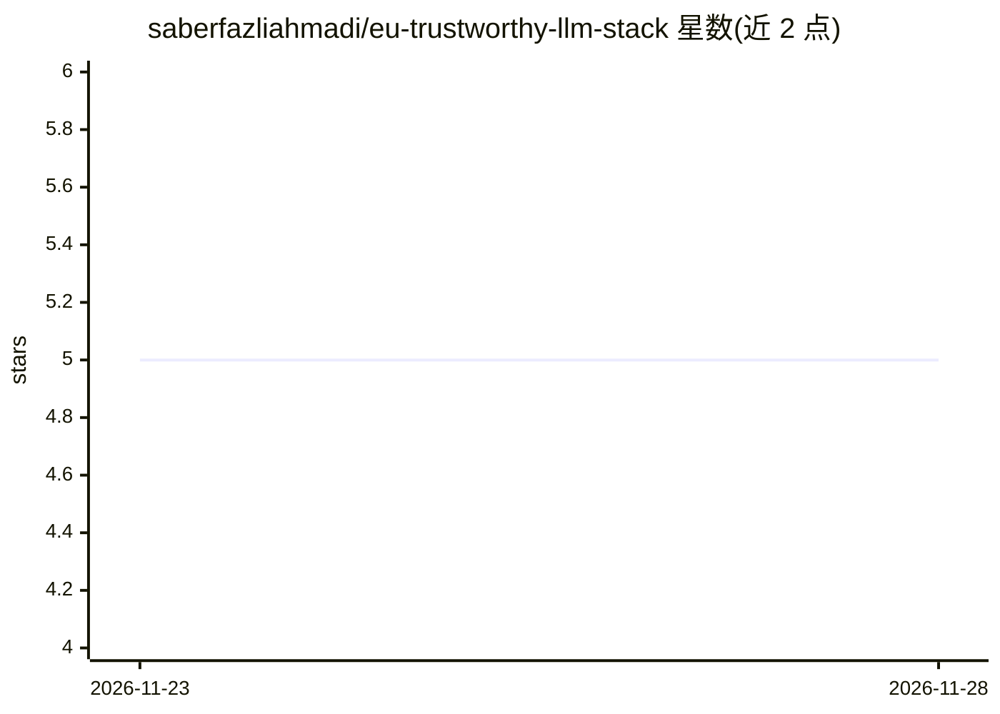

# saberfazliahmadi/eu-trustworthy-llm-stack

⭐ 5 · Python · MIT · 推送 2026-11-22 · [GitHub](https://github.com/saberfazliahmadi/eu-trustworthy-llm-stack) · [官网](https://youtu.be/aAaHqpCTtXQ) · 个人维护

**EU AI Act 高风险 HR 助手的可信 LLM 参考实现与审计工具集**

以虚构德国 HR 助手（ExampleHR）为例的开源参考工程：FastAPI 服务 + 五层安全栈（输入检查、guard 模型、RAG 核心模型、输出过滤、人工审查），配 FActScore 事实核查、公平性/红队审计、PyTorch 实验。离线模式用种子化的 MockLLMProvider 模拟器，可设 LLM_PROVIDER=openai/hf 接入真实模型。91 个 CI 测试与 7 个 trust gate 自动运行，pip 安装后无需 API key、GPU 或联网。声明为教学原型，非生产认证。

## 筛选速览

| 维度 | 判定 | 备注 |
|---|---|---|
| AI 角色 | `ai-native` | 本体是模型或模型工具 |
| 许可风险 | `permissive` | MIT |
| 部署形态 | `self-host` | docker 或自建部署 |
| 模型依赖 | local-ok | 支持本地模型 |
| 硬件要求 | — | 无带数字的原话,不猜 |
| 安装摩擦 | `low` | 无编译、无系统依赖或容器化 |
| 成熟度 | `idea` | |

## 能力要点

- 五层安全栈：rate limit、8 类 HR 危害分类、RAG 引用作答、输出过滤、人工审查工单
- FActScore 逐事实核查，输出答案+引用+逐层 trace
- 91 个离线测试与 7 个 CI trust gate（ASR≤0.10、FActScore≥0.85 等）
- 公平性交叉审计（z 检验、WEAT、PyTorch loss reweighting）与红队评估

## 适用场景

- 参考其架构为高风险场景 LLM 应用搭建安全护栏与审计体系
- 离线复现并核对全部安全/公平性指标后再接入真实模型
- 教学场景演示 EU AI Act Annex III 高风险 AI 的工程化合规实践
- 用红队 runner 与 LLM judge 评测自己的 RAG 系统

## 场景标签

`RAG` `模型评测` `AI 助手` · 领域:对话与助手

## 证据(README 行号)

> L11: **ExampleHR Assistant** is a fictional AI assistant for HR and careers in Germany. It answers questions about compa
> L47: pip install -e ".[dev]"  &&  python -m pytest  &&  python -m trust_llm.cli run-all
> L50: This one line installs the project, runs all 91 tests and runs every audit. It works **fully offline: no API key, n
> L103: |`providers/`|Connects to an AI model: the offline simulator or a real one|`LLMProvider` / `EmbeddingProvider` int

## 星数曲线

2026-11-23 5 → 2026-11-28 5（+0）

---
*卡片 v1 · prompt 1.4 · 生成 2026-11-23 · 置信度 mid · 依据 README sha `17ca8872b732` · [字段定义](../../DATASET.md)*
