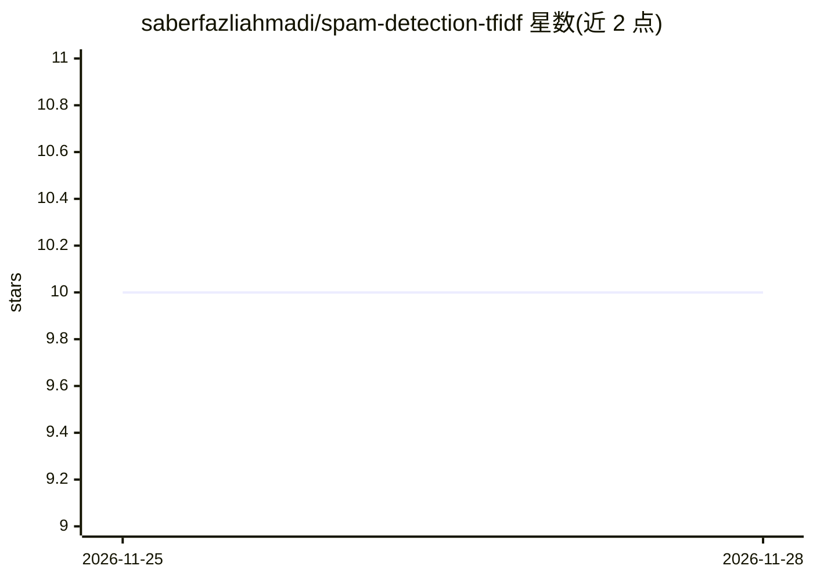

# saberfazliahmadi/spam-detection-tfidf

⭐ 10 · Jupyter Notebook · 推送 2026-11-22 · [GitHub](https://github.com/saberfazliahmadi/spam-detection-tfidf) · 个人维护

**用 TF-IDF 与决策树做短信垃圾信息分类的实验项目**

以 notebook 为载体的文本分类研究项目：清洗短信/邮件文本、提取 TF-IDF 特征、训练逻辑回归与决策树（含网格搜索调参），在 SMS Spam Collection（5,572 条）与 Enron 语料（33,716 条）上比较表现，并测试跨数据集迁移，输出准确率、混淆矩阵与树深度分析等可视化。仓库自称是研究/分析项目而非打包应用，主要价值在 notebook 实验与文档说明，数据集与依赖随仓库提供，通过 git clone 与 pip 安装后运行 Jupyter 复现。

## 筛选速览

| 维度 | 判定 | 备注 |
|---|---|---|
| AI 角色 | `ai-knowledge` | 知识聚合/清单类 |
| 许可风险 | `none` | — |
| 部署形态 | `library` | 以包/库形式分发 |
| 模型依赖 | — | README 未给出锁定关系 |
| 硬件要求 | — | 无带数字的原话,不猜 |
| 安装摩擦 | `low` | 无编译、无系统依赖或容器化 |
| 成熟度 | — | 结构信号不足 |

## 能力要点

- 逻辑回归基线与决策树（max_depth/min_samples_split 网格搜索）对比
- SMS 与 Enron 两个数据集及跨数据集泛化实验
- 输出准确率、混淆矩阵、树深度-准确率曲线等可视化
- 数据集 CSV 随仓库提供，notebook 可按序复现实验

## 适用场景

- 学习 NLP 文本预处理与 TF-IDF 特征工程流程
- 复现并比较经典机器学习分类模型的评估工作流
- 研究模型跨数据集（短信 vs 邮件）泛化表现

## 场景标签

 · 领域:机器学习/自然语言处理

## 证据(README 行号)

> L23: This is a research/analysis project rather than a packaged application, so the main value is in the notebook-based 
> L257: - This repository is mainly a research and analysis project, not a production-ready API or web application.

## 星数曲线

2026-11-25 10 → 2026-11-28 10（+0）

---
*卡片 v1 · prompt 1.4 · 生成 2026-11-24 · 置信度 high · 依据 README sha `3097dc1eb6b4` · [字段定义](../../DATASET.md)*
