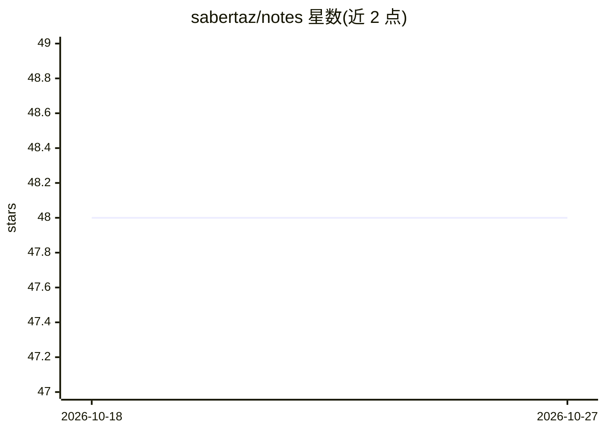

# sabertaz/notes

⭐ 48 · TypeScript · MIT · 推送 2026-10-15 · [GitHub](https://github.com/sabertaz/notes) · [官网](https://notes.tazimi.dev) · 个人维护

**个人技术学习笔记仓库（today I learned）**

个人维护的知识笔记仓库，以 "today I learned" 形式记录学习内容，主题标签覆盖算法、函数式编程、Haskell、JavaScript、CSS、数据库、LLM 与 agent 等。README 仅含标题、徽章与 MIT 许可声明，未列出具体笔记内容或使用方式。无安装、运行或贡献流程说明，属于个人知识记录而非可部署软件。

## 筛选速览

| 维度 | 判定 | 备注 |
|---|---|---|
| AI 角色 | `ai-knowledge` | 知识聚合/清单类 |
| 许可风险 | `permissive` | MIT |
| 部署形态 | `None` |  |
| 模型依赖 | — | README 未给出锁定关系 |
| 硬件要求 | — | 无带数字的原话,不猜 |
| 安装摩擦 | `low` | 无编译、无系统依赖或容器化 |
| 成熟度 | — | 结构信号不足 |

## 能力要点

- 以 TIL 形式记录个人学习笔记
- 主题覆盖算法、函数式编程、前端、数据库、LLM/agent 等
- MIT 许可开源

## 适用场景

- 浏览个人学习笔记获取知识点
- 参考知识整理方式

## 场景标签

 · 领域:通用技术笔记

## 证据(README 行号)

> L8: Personal notes: today I learned.

## 星数曲线

2026-10-18 48 → 2026-10-27 48（+0）

---
*卡片 v1 · prompt 1.4 · 生成 2026-10-25 · 置信度 mid · 依据 README sha `a323b20e41fc` · [字段定义](../../DATASET.md)*
