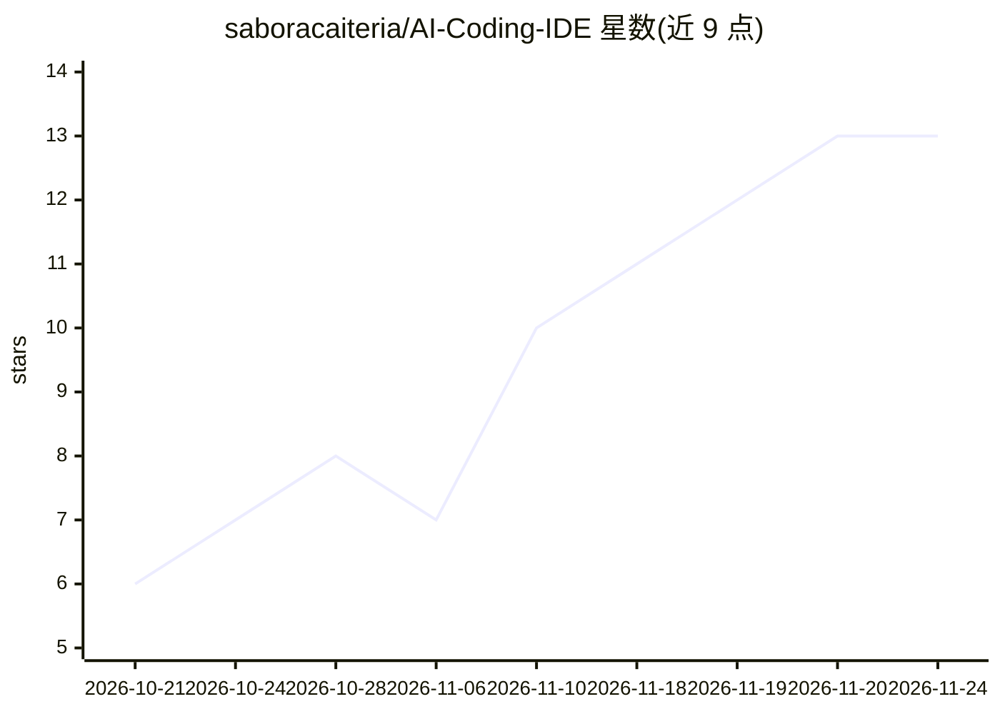

# saboracaiteria/AI-Coding-IDE

⭐ 13 · HTML · MIT · 推送 2026-11-23 · [GitHub](https://github.com/saboracaiteria/AI-Coding-IDE) · [官网](https://saboracaiteria.github.io/AI-Coding-IDE/) · 个人维护

**在 Android 手机上编译并安装 APK 的 AI 编码 IDE**

面向 Android 手机的移动开发环境，整合自主 AI Agent、设备端编译器（构建并签名 Kotlin/Java 项目的 .apk）、支持 50+ 语言语法高亮的代码编辑器、Linux 终端与 Git，并提供 APK 逆向检查（APKTool/Smali）与内置开发者聊天。模型接入侧可配置 DeepSeek、Claude、GPT-4o、Gemini、NVIDIA NIM、OpenRouter 或本地 GGUF 模型；代码与构建产物保留在本机存储。以 APK 安装包分发，兼容 Android 8.0 至 15。

## 筛选速览

| 维度 | 判定 | 备注 |
|---|---|---|
| AI 角色 | `ai-enhanced` | 去掉 AI 部分产品仍成立 |
| 许可风险 | `permissive` | MIT |
| 部署形态 | `None` |  |
| 模型依赖 | local-ok | 支持本地模型 |
| 硬件要求 | — | 无带数字的原话,不猜 |
| 安装摩擦 | `low` | 无编译、无系统依赖或容器化 |
| 成熟度 | `idea` | |

## 能力要点

- 设备端编译并一键安装 .apk（宣称 ~12 秒完成 Kotlin/Java 项目构建）
- AI Agent 读取文件、生成 diff、运行终端命令并验证结果（17+ 工具）
- JEv 扫描引擎在调用 LLM 前解析 AST/符号/二进制结构以减少 token 用量
- 多模型接入：DeepSeek/Claude/GPT-4o/Gemini/NVIDIA NIM/OpenRouter/本地 GGUF

## 适用场景

- 无 PC 时在手机上编写、编译并安装 Android 应用
- 离线环境下用本地 GGUF 模型做代码生成与调试
- 反编译检查 APK 头部、DEX 类数与原生 ABI
- 通过内置聊天与其他开发者交流代码问题

## 场景标签

`代码生成` `编码 Agent` · 领域:编码与开发

## 证据(README 行号)

> L37: **AI Coding IDE** transforms any modern Android smartphone into a complete, self-contained software engineering wor
> L39: Equipped with an **Autonomous AI Agent**, an ultra-fast **On-Device Native Compiler**, a professional **Code Editor
> L50: * **Full Agentic Workflow:** The AI doesn't just predict code—it reads files, plans complex tasks, writes surgical 

## 星数曲线

2026-10-21 6 → 2026-11-24 13（+7）

---
*卡片 v1 · prompt 1.4 · 生成 2026-11-18 · 置信度 mid · 依据 README sha `3244fa12fbef` · [字段定义](../../DATASET.md)*
